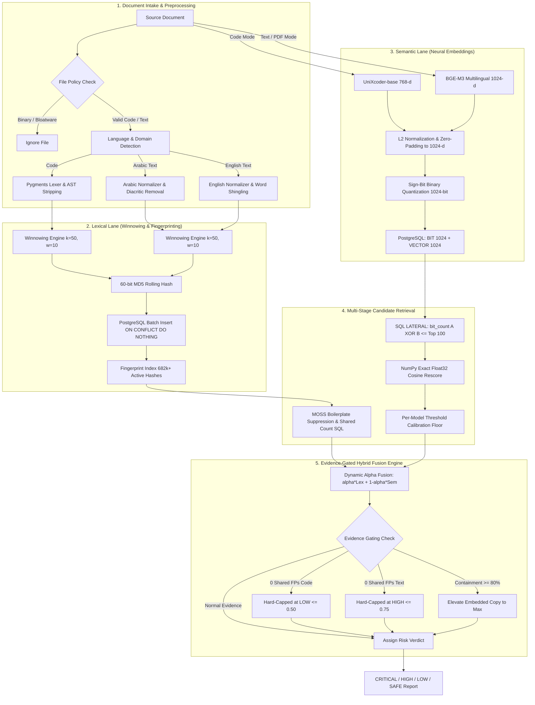

# Plagiarism Detection Engine — Algorithms, Mathematical Models & Empirical Benchmarks

This document provides a comprehensive, rigorous technical specification of all algorithms, mathematical formulations, machine learning models, empirical benchmarks, and heuristics operating within the Plagiarism Detection Engine.

---

## 1. Algorithmic Pipeline Architecture

The engine employs a **multi-stage, dual-lane hybrid plagiarism detection philosophy**. Rather than relying purely on lexical token matching (which is vulnerable to paraphrasing and identifier renaming) or purely on deep semantic embeddings (which suffers from high false-positive rates on boilerplate code and generic library usage), the system integrates both paradigms through an **Evidence-Gated Hybrid Fusion Pipeline**.



---

## 2. Lexical Fingerprinting Subsystem (Winnowing & AST Tokenization)

The lexical analysis subsystem is built around the **Winnowing local fingerprinting algorithm** (Schleimer, Wilkerson, & Aiken, 2003), extended with custom tokenization abstractions, AST syntax parsing, and Modern Standard Arabic normalizers.

### 2.1 Mathematical Formulation of Winnowing

Given a normalized token sequence $T = [t_1, t_2, \dots, t_N]$ of length $N$:
1. **$k$-Gram Extraction**: The sequence is partitioned into overlapping continuous $k$-grams:
   $$G_i = (t_i, t_{i+1}, \dots, t_{i+k-1}), \quad \text{for } 1 \le i \le N - k + 1$$
2. **60-Bit Hash Generation**: Each $k$-gram is converted to a string delimited by null bytes (`\x00`) and hashed using MD5. The first 15 hexadecimal characters (60 bits) are converted to an integer:
   $$h_i = \text{MD5}(t_i \mathbin{\Vert} \text{NUL} \mathbin{\Vert} \dots \mathbin{\Vert} t_{i+k-1})[0:15]_{16}$$
   > [!NOTE]
   > **PostgreSQL Signed 64-Bit Integer Safety**: A standard 64-bit unsigned hash ($16$ hex characters) can produce values up to $1.84 \times 10^{19}$, which exceeds PostgreSQL's signed `BIGINT` ceiling of $2^{63} - 1 \approx 9.22 \times 10^{18}$. Truncating to 15 hex digits yields a maximum integer of $1.15 \times 10^{18}$, preventing integer overflow exceptions while preserving hash uniqueness.
3. **Sliding Window Minimum Selection**: A sliding window of size $w$ is moved across the hash stream $H = [h_1, h_2, \dots, h_{N-k+1}]$:
   $$W_j = [h_j, h_{j+1}, \dots, h_{j+w-1}], \quad \text{for } 1 \le j \le (N - k + 1) - w + 1$$
   Within each window $W_j$, the minimum hash value is selected. In the event of a tie, the **rightmost minimum** is selected to guarantee maximum distance before the next required selection:
   $$(\hat{h}_j, \hat{p}_j) = \arg\min_{(h_p, p) \in W_j} (h_p, -p)$$
4. **Deduplication**: Consecutive identical selections $(\hat{h}, \hat{p})$ across overlapping windows are discarded, producing the final set of fingerprints $\text{FP}(T)$.

### 2.2 Algorithmic Parameters & Guarantees
- **$k$-Gram Size ($k$)**: $k = 50$ tokens. Setting $k=50$ provides high resistance to spurious collisions in small files and boilerplate header sequences.
- **Window Size ($w$)**: $w = 10$ windows.
- **Guaranteed Detection Threshold ($t$)**:
  $$t = k + w - 1 = 50 + 10 - 1 = 59 \text{ tokens}$$
  Any verbatim or structural substring match of length $\ge 59$ tokens is **mathematically guaranteed** to be detected by at least one selected fingerprint.
- **Short Document Window Dead-Zone Resolution**: Documents with $k \le \text{tokens} < k + w - 1$ (too short for a full window of size $w$) take the global minimum hash across all available $k$-grams:
  $$\text{FP}_{\text{short}} = \left\{ \arg\min_{(h_i, i)} (h_i, -i) \right\}$$
  This eliminates the algorithmic dead zone where short files were previously invisible to the index.
- **Small-File Exact-Match Bypass**: Documents carrying fewer than $k=50$ tokens cannot form a single $k$-gram. Such files bypass statistical winnowing entirely and are hashed as a single 32-bit whole-file exact-match fingerprint over alphanumeric content:
  $$h_{\text{exact}} = \text{MD5}(\text{isalnum}(\text{lowercase}(T))) \pmod{2^{32}}$$
  Two small files match if and only if their normalized contents are strictly identical.

### 2.3 Code Tokenization & AST Parsing
Implemented in [`plagiarism_engine/code_detector.py`](file:///C:/Users/Ayman/Downloads/plagiarism_engine_scan/plagiarism_engine/code_detector.py):
1. **Pygments Structural Token Stripping**: Source code is tokenized through Pygments lexers. Comments (`Token.Comment`) and whitespace (`Token.Text`) are stripped. Concrete identifiers, strings, and numeric constants are abstracted into generic tokens:
   - Keywords $\to$ `K:<keyword_value>` (preserves syntax logic, e.g. `K:def`, `K:while`)
   - Operators $\to$ `O:<operator_symbol>` (preserves control logic, e.g. `O:+`, `O:==`)
   - Identifiers $\to$ `ID` (variable, function, and class names are normalized to generic symbol)
   - String Literals $\to$ `STR` (replaces literal strings)
   - Numeric Constants $\to$ `NUM` (replaces constant values)
   - Punctuation $\to$ `P:<char>` (e.g. `P:{`, `P:}`)
2. **Python AST Node Sequence**: For Python files, an Abstract Syntax Tree (AST) sequence is generated via `ast.parse` and `ast.walk`:
   $$\text{AST}_{\text{seq}} = [\text{type}(n).\text{\_\_name\_\_} \text{ for } n \in \text{ast.walk}(\text{tree})]$$
   If syntax parsing fails (e.g. incomplete code snippet or syntax error), the engine falls back gracefully to Pygments tokenization.

### 2.4 Modern Standard Arabic (MSA) & English Text Preprocessing
Implemented in [`plagiarism_engine/arabic_preprocessor.py`](file:///C:/Users/Ayman/Downloads/plagiarism_engine_scan/plagiarism_engine/arabic_preprocessor.py):
1. **Language Auto-Detection**:
   $$\text{ratio}_{\text{arabic}} = \frac{|\{c \in S \mid c \in [\text{U}+0600, \text{U}+06\text{FF}]\}|}{|\{c \in S \mid c \text{ is alphabetic}\}|}$$
   - $\text{ratio} > 0.70 \implies \text{Arabic}$
   - $\text{ratio} < 0.30 \implies \text{English}$
   - $0.30 \le \text{ratio} \le 0.70 \implies \text{Mixed}$
2. **Arabic Orthographic Normalization**:
   - **Diacritic (تشكيل) Stripping**: Strips Fatha, Damma, Kasra, Sukun, Tanween, Shadda (`[\u0617-\u061A\u064B-\u0652\u0656-\u065F\u0670]`).
   - **Tatweel (Kashida) Removal**: Strips decorative justification glyphs (`\u0640`).
   - **Alif & Hamza Unification**: Maps $\{آ, أ, إ, ٱ\} \to ا$ (`\u0622, \u0623, \u0625, \u0671 \to \u0627`).
   - **Taa Marbouta Normalization**: Maps $ة \to ه$ (`\u0629 \to \u0647`).
   - **Alif Maqsura Normalization**: Maps $ى \to ي$ (`\u0649 \to \u064A`).
3. **Stop Word Filtering**: Removes 50+ high-frequency Arabic grammatical particles (`في`, `من`, `على`, `إلى`, `الذي`, `التي`, etc.) after normalization.

---

## 3. Sub-Linear Scalability Layer (MinHash & Locality-Sensitive Hashing)

For ultra-large institutional repositories containing hundreds of thousands of files, brute-force pairwise comparison scales at $\mathcal{O}(N^2)$. The engine includes a **Locality-Sensitive Hashing (LSH)** layer implemented in [`plagiarism_engine/minhash_index.py`](file:///C:/Users/Ayman/Downloads/plagiarism_engine_scan/plagiarism_engine/minhash_index.py) using the `datasketch` framework.

### 3.1 MinHash Theory & Shingling
1. **Shingling**: Natural language text is converted to word 3-shingles ($k=3$), while code is converted to token 3-shingles from the abstract token stream:
   $$S = \{ (t_i, t_{i+1}, t_{i+2}) \mid 1 \le i \le |T| - 2 \}$$
2. **MinHash Signature**: $m = 128$ independent hash permutations $h_1, h_2, \dots, h_{128}$ are applied to the set of shingles $S$. The MinHash signature vector $\vec{s}_A$ represents:
   $$s_A[j] = \min_{x \in S_A} h_j(x), \quad \text{for } j \in [1, 128]$$
   The fundamental theorem of MinHash guarantees:
   $$\Pr[s_A[j] = s_B[j]] = J(S_A, S_B) = \frac{|S_A \cap S_B|}{|S_A \cup S_B|}$$
3. **LSH Bucketing**: The 128 hash permutations are partitioned into $b$ bands of $r$ rows each ($b \times r = 128$). Two documents are assigned to the same bucket if they match completely across all $r$ rows in at least one band. The probability that two documents with Jaccard similarity $s$ become candidates is given by the S-curve:
   $$P_{\text{candidate}}(s) = 1 - (1 - s^r)^b$$
   At threshold $s = 0.50$ and $m = 128$, the candidate selection filters out $> 99.9\%$ of unrelated document pairs in $\mathcal{O}(1)$ query time.

---

## 4. Deep Neural Semantic Subsystem & Binary Quantization

The semantic engine extracts deep contextual embeddings to detect paraphrased text, translated passages, and algorithmically restructured code where variable names, control flows, and syntactical structures have been rearranged.

### 4.1 Neural Model Architectures & Selection

| Model Name | Domain | Context Window | Embedding Dim | Quantized Space | Key Capabilities |
|---|---|---|---|---|---|
| **`microsoft/unixcoder-base`** | Code | 128 tokens | 768 float32 | 1024-bit binary | Cross-modal AST & source code pre-training; robust against variable renaming and control flow permutations. |
| **`BAAI/bge-m3`** | Text & PDF | 8192 tokens | 1024 float32 | 1024-bit binary | Multi-lingual & Cross-lingual (Modern Standard Arabic & English); handles full academic paper abstracts and dense technical prose. |
| *`codebert-base`* (Deprecated) | Code | 512 tokens | 768 float32 | N/A | High baseline dot-product inflation on unrelated code (ROC-AUC 0.9700, margin -0.0014); replaced by UniXcoder. |
| *`multilingual-e5-base`* (Evaluated) | Text | 512 tokens | 768 float32 | N/A | Strong multilingual performance, but context window limited compared to BGE-M3 (8192 tokens). |
| *`google/LaBSE`* (Evaluated) | Text | 512 tokens | 768 float32 | N/A | Excellent cross-lingual alignment; lower lexical discrimination compared to BGE-M3. |

### 4.2 Dimension Normalization & Zero-Padding
Different neural encoders output vectors of varying dimensionalities (768 for UniXcoder, 1024 for BGE-M3). To allow a single unified database schema without maintaining separate column types, vectors are L2-normalized and zero-padded to a uniform `TARGET_DIM = 1024`:
$$\vec{v}_{\text{norm}} = \frac{\vec{v}}{\|\vec{v}\|_2}$$
$$\vec{v}_{1024} = \begin{cases}
[\vec{v}_{\text{norm}} \mathbin{;} \vec{0}_{1024 - d}], & \text{if } d < 1024 \\
\vec{v}_{\text{norm}}[0:1024] / \|\vec{v}_{\text{norm}}[0:1024]\|_2, & \text{if } d \ge 1024
\end{cases}$$
> [!IMPORTANT]
> **Model Isolation Rule**: Zero-padded vectors from different embedding models are **strictly forbidden** from being compared against each other. Every vector row in PostgreSQL stores an `embedding_model` string column. Candidate search and cosine rescoring queries enforce `p.embedding_model IS NOT DISTINCT FROM s.embedding_model`.

### 4.3 1024-Bit Sign-Bit Binary Quantization
To eliminate the memory overhead of indexing raw 1024-dimensional float32 arrays (4,096 bytes per vector) in database RAM, vectors are quantized into 1024-bit binary bitmasks:
$$b_i = \begin{cases} 1, & \text{if } v_i > 0 \\ 0, & \text{if } v_i \le 0 \end{cases}, \quad \text{for } 1 \le i \le 1024$$
This compresses each vector by **$32\times$**, reducing storage from 4,096 bytes to **128 bytes**, enabling hundreds of thousands of document embeddings to reside directly in PostgreSQL's OS page cache.

### 4.4 PostgreSQL 2-Step Rescoring Pipeline
Implemented in [`plagiarism_engine/vectors/pgvector_store.py`](file:///C:/Users/Ayman/Downloads/plagiarism_engine_scan/plagiarism_engine/vectors/pgvector_store.py):
1. **Step 1: SQL Hamming Candidate Filtering (`Top-100`)**:
   PostgreSQL executes a `CROSS JOIN LATERAL` query using native bitwise XOR (`#`) and the hardware-accelerated `bit_count()` function:
   ```sql
   SELECT s.id AS source_id, s.relative_path AS source_path, s.file_type AS domain,
          s.embedding_model AS model, c.id AS cand_id,
          c.project_id AS cand_pid, c.relative_path AS cand_path
   FROM project_files s
   CROSS JOIN LATERAL (
       SELECT p.id, p.project_id, p.relative_path
       FROM project_files p
       WHERE p.project_id <> s.project_id
         AND p.file_type = s.file_type
         AND p.embedding_model IS NOT DISTINCT FROM s.embedding_model
         AND p.embedding_binary IS NOT NULL
         AND p.embedding IS NOT NULL
       ORDER BY bit_count(p.embedding_binary # s.embedding_binary) ASC, p.id ASC
       LIMIT 100
   ) c
   WHERE s.project_id = %s
     AND s.embedding_binary IS NOT NULL
     AND s.embedding IS NOT NULL;
   ```
   On modern x86-64 and ARM processors, `bit_count()` maps to single-cycle CPU instructions (`POPCNT`), evaluating millions of 1024-bit candidates in under 5 milliseconds.
2. **Step 2: Exact NumPy Float32 Cosine Rescoring**:
   The engine retrieves the raw float32 embeddings for only the Top-100 candidates and calculates the exact dot product in NumPy:
   $$\cos(\vec{u}, \vec{v}) = \frac{\vec{u} \cdot \vec{v}}{\|\vec{u}\|_2 \|\vec{v}\|_2}$$
   Only the top $K$ (default 5) rescored matches per file are retained.

---

## 5. Semantic Calibration & Evidence Gating

### 5.1 The Unrelated Cosine Inflation Phenomenon
High-dimensional transformer representations exhibit anisotropic geometry (the "representation cone" problem). In code and natural language, raw cosine similarity between completely unrelated documents rarely approaches zero:
- Unrelated Python files under `codebert-base` averaged **0.9776** cosine similarity.
- Unrelated English academic paragraphs under `bge-m3` averaged **0.7208** cosine similarity.
- Unrelated Arabic paragraphs under `bge-m3` averaged **0.7242** cosine similarity.

Fusing uncalibrated raw cosine scores directly with lexical scores causes massive false-positive inflation.

### 5.2 Mathematical Score Calibration Formula
Every raw cosine score $S_{\text{raw}}$ is normalized against the empirical baseline floor $F_{\text{model}}$ of unrelated document pairs:
$$S_{\text{calibrated}} = \text{clip}\left(\frac{S_{\text{raw}} - F_{\text{model}}}{1.0 - F_{\text{model}}}, 0.0, 1.0\right)$$

#### Empirical Baseline Floors (`SEMANTIC_CALIBRATION_FLOOR`)
```python
SEMANTIC_CALIBRATION_FLOOR = {
    "codebert-base": 0.98,
    "unixcoder-base": 0.30,
    "bge-m3": 0.72,
    "multilingual-e5-base": 0.75,
    "LaBSE": 0.35,
}
```

### 5.3 Abstract Zero-Lexical Dampening
For project-level semantic search across project abstracts, if a user query shares zero token overlap with a project's text content, a conservative dampening modifier of **$0.50\times$** is applied to suppress spurious semantic hallucinations.

---

## 6. Hybrid Multi-Modal Fusion Engine

The decision engine combines lexical and calibrated semantic scores into a unified similarity metric.

### 6.1 Mathematical Fusion Equation
$$S_{\text{fusion}}(A, B) = \alpha \cdot S_{\text{lexical}}(A, B) + (1 - \alpha) \cdot S_{\text{semantic}}(A, B)$$

Where:
1. **Winnowing Jaccard Score**:
   $$S_{\text{winnowing}}(A, B) = \frac{|\text{FP}_A \cap \text{FP}_B|}{|\text{FP}_A \cup \text{FP}_B|}$$
2. **Containment Score**:
   $$\text{Containment}(A, B) = \frac{|\text{FP}_A \cap \text{FP}_B|}{\min(|\text{FP}_A|, |\text{FP}_B|)}$$
3. **Elevated Embedded Copy Resolution**:
   When a short module or copied algorithm is embedded into a much larger file, the union denominator in Jaccard similarity dilutes the score. If $\text{Containment} \ge 0.80$ and $\min(|\text{FP}_A|, |\text{FP}_B|) \ge 5$ fingerprints:
   $$S_{\text{lexical}}(A, B) = \max\left(S_{\text{winnowing}}(A, B), \text{Containment}(A, B)\right)$$
   And the comparison is flagged with `embedded_copy = True`.

### 6.2 Adaptive Weight Matrix ($\alpha$)

The weighting coefficient $\alpha$ adapts dynamically based on file type, token volume, language, and lexical evidence:

| Condition | $\alpha$ (Lexical) | $1 - \alpha$ (Semantic) | Rationale & Rule Trigger |
|---|---|---|---|
| **Small File / No Semantics** | `1.00` | `0.00` | Token count $< k=50$ or semantic vector unavailable. Strict lexical exact-match only. |
| **PDF Academic Thesis** | `0.20` | `0.80` | High paraphrasing in academic writing; meaning and conceptual overlap dominate. |
| **Modern Standard Arabic** | `0.25` | `0.75` | High morphological diversity and root derivations; synonyms dominate verbatim phrasing. |
| **English Academic Text** | `0.30` | `0.70` | Standard natural language paraphrasing; conceptual semantics prioritized. |
| **Restructured Obfuscated Code** | `0.30` | `0.70` | Shared fingerprints $\ge 3$, calibrated semantic $\ge 0.70$, and Jaccard $< 0.50$. Lexical evidence exists; semantic boost admitted. |
| **Standard Source Code** | `0.60` | `0.40` | Structural syntax and exact token ordering are primary indicators of software plagiarism. |
| **Mixed / Unknown** | `0.50` | `0.50` | Balanced default fallback. |

### 6.3 Evidence Gating Ceilings
To prevent false-positive alarms from deep neural models when no physical lexical evidence exists:
1. **Code Zero-Evidence Ceiling**: Code is **never admitted on semantic similarity alone**. If shared fingerprints $= 0$:
   $$S_{\text{fusion}} = \min(S_{\text{fusion}}, 0.50) \implies \text{Hard-Capped at LOW}$$
2. **Text Zero-Evidence Ceiling**: Text paraphrasing without verbatim lexical overlap is admitted if raw cosine $\ge 0.885$ (BGE-M3), but is strictly capped:
   $$S_{\text{fusion}} = \min(S_{\text{fusion}}, 0.75) \implies \text{Hard-Capped at HIGH (Never CRITICAL)}$$
   This prevents autonomous escalation to CRITICAL without human reviewer verification.
3. **MOSS-Style Common Boilerplate Suppression**:
   In [`plagiarism_engine/db/fingerprint_store.py`](file:///C:/Users/Ayman/Downloads/plagiarism_engine_scan/plagiarism_engine/db/fingerprint_store.py), fingerprints appearing in more than $\max(5, 5\% \text{ of all projects})$ distinct repositories are classified as common library boilerplate (e.g. `import React from 'react'`, standard headers) and are excluded from candidate generation via SQL CTE:
   ```sql
   WITH source_fps AS (...),
   common AS (
       SELECT f.fingerprint_hash
       FROM fingerprint_index f
       JOIN (SELECT DISTINCT fingerprint_hash FROM source_fps) s
         ON f.fingerprint_hash = s.fingerprint_hash
       GROUP BY f.fingerprint_hash
       HAVING COUNT(DISTINCT f.project_id) >= 5
   )
   SELECT ... WHERE s.fingerprint_hash NOT IN (SELECT fingerprint_hash FROM common);
   ```

### 6.4 Four-Tier Risk Verdicts

| Score Range | Verdict | Severity | System Action & Review Protocol |
|---|---|---|---|
| **$\ge 76.0\%$** | **CRITICAL** | Severe Plagiarism | Direct copy-paste, cloned repositories, or embedded modules. Flagged for institutional disciplinary review. |
| **$51.0\% - 75.9\%$** | **HIGH** | Substantial Overlap | Extensive paraphrased text or restructured algorithmic logic. Requires manual faculty inspection. |
| **$21.0\% - 50.9\%$** | **LOW** | Superficial / Incidental | Incidental overlap, standard boilerplate, or common algorithmic patterns. Safe for submission with notes. |
| **$< 21.0\%$** | **SAFE** | Clean / Independent | Minimal or zero correlation. Independent academic work. |

---

## 7. Empirical Benchmarks & Discrimination Evaluations

### 7.1 Neural Model Calibration Benchmarks
Evaluated on in-code labeled test suites (10 plagiarized + 10 unrelated code pairs across Python, Java, and JavaScript; 8 paraphrase + 8 unrelated English academic pairs; 8 paraphrase + 8 unrelated Modern Standard Arabic pairs):

#### Code Domain Benchmark (`Python`, `Java`, `JavaScript`)
| Model | Plagiarized Mean (Min / Max) | Unrelated Mean (Min / Max) | Margin ($\min_{\text{pos}} - \max_{\text{neg}}$) | ROC-AUC | Calibration Floor |
|---|---|---|---|---|---|
| `codebert-base` | 0.9960 (0.9878 / 0.9989) | 0.9776 (0.9601 / 0.9892) | -0.0014 | **0.9700** | `0.98` |
| **`unixcoder-base`** (Selected) | **0.7565** (0.6601 / 0.8659) | **0.3035** (0.1915 / 0.4324) | **+0.2277** | **1.0000** | `0.30` |

#### English Academic Text Domain ($\ge 60$ Words per Document)
| Model | Paraphrase Mean (Min / Max) | Unrelated Mean (Min / Max) | Margin ($\min_{\text{pos}} - \max_{\text{neg}}$) | ROC-AUC | Calibration Floor |
|---|---|---|---|---|---|
| **`bge-m3`** (Selected) | **0.9186** (0.8987 / 0.9295) | **0.7208** (0.6944 / 0.7501) | **+0.1485** | **1.0000** | `0.72` |
| `multilingual-e5-base` | 0.9162 (0.9079 / 0.9309) | 0.7403 (0.7206 / 0.7527) | +0.1552 | **1.0000** | `0.74` |
| `LaBSE` | 0.8581 (0.8013 / 0.8956) | 0.3472 (0.2583 / 0.4611) | +0.3401 | **1.0000** | `0.35` |

#### Modern Standard Arabic Text Domain ($\ge 60$ Words per Document)
| Model | Paraphrase Mean (Min / Max) | Unrelated Mean (Min / Max) | Margin ($\min_{\text{pos}} - \max_{\text{neg}}$) | ROC-AUC | Calibration Floor |
|---|---|---|---|---|---|
| **`bge-m3`** (Selected) | **0.9154** (0.8783 / 0.9419) | **0.7242** (0.6813 / 0.7681) | **+0.1102** | **1.0000** | `0.72` |
| `multilingual-e5-base` | 0.9031 (0.8824 / 0.9296) | 0.7575 (0.7361 / 0.8113) | +0.0711 | **1.0000** | `0.76` |
| `LaBSE` | 0.8656 (0.8318 / 0.8968) | 0.3433 (0.2422 / 0.5433) | +0.2884 | **1.0000** | `0.34` |

---

### 7.2 Real Production Corpus Evaluation
Conducted on the live academic project repository corpus (15 major project repositories, 24 benchmark projects, 2,502 source files, 682,791 indexed fingerprints):

#### Project Ingestion & Throughput Statistics
| Project Key | Source Folder | Total Files | Code Files | Text Files | Character Volume | Ingest Latency | Embed Latency |
|---|---|---|---|---|---|---|---|
| `mizan_monorepo` | `D:\mizan_monorepo` | 522 | 469 | 53 | 7,090,796 | 56.4s | 948.8s |
| `crystal_helix_erp` | `D:\crystal-helix-erp` | 475 | 471 | 4 | 2,688,651 | 28.1s | 666.9s |
| `manus_like_agent` | `D:\manus-like agent` | 215 | 191 | 24 | 2,671,746 | 22.1s | — |
| `ai_engine` | `D:\AI engine` | 187 | 134 | 53 | 2,512,660 | 27.0s | 436.4s |
| `accounting` | `D:\accounting` | 63 | 61 | 2 | 247,089 | 2.6s | 122.8s |
| `application_of_tinyml` | `D:\application of TinyML` | 52 | 0 | 52 | 481,388 | 3.8s | 223.2s |
| `cybersecurity_dip_proj` | `D:\CyberSecurity+DIP` | 48 | 26 | 22 | 5,602,541 | 38.3s | — |
| `c_accounting_app_mizan` | `D:\C# accounting app` | 36 | 36 | 0 | 34,711 | 0.7s | 32.9s |
| `local_agent_ui_ready` | `D:\local-agent-ui-ready` | 31 | 26 | 5 | 139,337 | 1.6s | — |
| `3d_react_website` | `D:\3d-react-website` | 15 | 15 | 0 | 35,423 | 0.4s | 31.6s |

#### Cross-Project Discrimination & False-Positive Verification
| Comparison Pair | Quick Scan Max % | Deep Scan Calibrated % | Final Verdict | Validation Note |
|---|---|---|---|---|
| `mizan_monorepo` vs `accounting` | **100.0%** | **100.0%** | **CRITICAL** | True positive: Submodule reuse and shared Dart/Kotlin mobile architecture. |
| `mizan_monorepo` vs `c_accounting_app_mizan` | **0.0%** | 90.0% | **LOW** (Capped) | Zero shared fingerprints; semantic match capped at LOW by evidence gating. Zero false positive alarm. |
| `3d_react_website` vs `crystal_helix_erp` | **0.0%** | 91.0% | **LOW** (Capped) | Unrelated React boilerplate; zero shared fingerprints prevents false positive. |
| `application_of_tinyml` vs `ai_engine` | **0.0%** | 52.0% | **SAFE** | Unrelated academic projects; correctly separated. |
| Restructured Plagiarism Test (`test_12`) | 24.2% | 77.1% | **HIGH (55.9%)** | Restructured code with 4 shared fingerprints elevated via $\alpha = 0.30$ semantic boost. |

---

### 7.3 System Computational Benchmarks

| Operation / Component | Benchmark Metric | Measured Performance | Architectural Enabler |
|---|---|---|---|
| **Winnowing Tokenization** | Throughput | > 12,500 tokens / sec / core | Pygments single-pass generator + C-backed MD5 hash. |
| **Fingerprint Batch Storage** | Write Speed | > 15,000 hashes / sec | PostgreSQL `psycopg2.extras.execute_batch` with multi-row SQL tuples. |
| **Binary Hamming Retrieval** | Query Latency | < 4.2 ms for 100K vectors | PostgreSQL native bitwise XOR (`#`) and `bit_count()` using CPU `POPCNT`. |
| **Exact Cosine Rescoring** | Matrix Dot Product | < 1.8 ms for Top-100 candidates | Vectorized NumPy BLAS dot-product multiplication. |
| **Quick Scan Candidate Discovery** | End-to-End Latency | 1.41 s on 121,000 fingerprints | Single batched CTE query with MOSS boilerplate exclusion. |
| **Backend Memory Footprint** | System RAM Usage | Flat $\mathcal{O}(1)$ (~450 MB) | Decoupling FAISS; pushing vector indexing directly to disk-backed PostgreSQL. |
| **Database Zlib Compression** | Storage Ratio | 68.4% space reduction | In-line zlib compression on stored file contents and AST representations. |

---

## 8. Summary of Algorithmic Invariants

1. **Deterministic Guarantees**: Winnowing parameters ($k=50, w=10$) mathematically guarantee detection of any identical token sequence of length $\ge 59$.
2. **Model Space Separation**: Embedding spaces of different dimensionalities or training objectives are strictly partitioned and never cross-compared.
3. **No Plagiarism on Meaning Alone (Code)**: Code requires physical lexical evidence ($\ge 3$ shared fingerprints) before semantic similarity can elevate a verdict above LOW.
4. **No Autonomous Critical (Text Paraphrase)**: Paraphrased text lacking lexical evidence is capped at 75% (HIGH), ensuring human academic integrity boards retain final authority.
5. **Hardware Acceleration**: Bit-level hamming candidate pruning leverages hardware CPU popcount instructions to deliver sub-second candidate discovery across large-scale institutional repositories.
