# Master UI/UX, Workflow Reorganization, Localization & Performance Plan

## Goal Description

This implementation plan delivers a comprehensive visual and operational refinement of the **Yemeni Higher Education Unified Graduation & Research Plagiarism System**. It directly resolves every root cause identified across user workflows, the audit report, and the `ui_polish_and_ux_plan.md` specification:

1. **Eliminating Scan History Latency (< 1 ms)**: Caching the 20 MB `scan_history.json` in thread-safe memory with mtime invalidation and SWR client caching.
2. **Instant In-UI Report Quick-View Modal**: Providing an interactive modal with executive KPIs, matched pairs, inline side-by-side diff viewer, PDF/TXT export, and "Open in Scanner Workspace".
3. **Resolving the Broken Empty `%` Similarity Bug**: Decoupling intake metadata from plagiarism scan results in `scanStore.ts`.
4. **Clarifying `/` (Project Intake) and `/scan` (Plagiarism Scanner)**:
   - On `/`: Streamlining Direct Upload and Git Clone into single unified cards with auto-detected project badges (with optional title override) and a 1-click transition to `/scan`.
   - On `/scan`: Segmenting the page into 3 focused workspaces (`Corpus Deep Scan`, `Compare Two Files`, `Compare Two Projects`) and fixing the `Run Comparison` button clipping.
5. **Calibrated Low-Glare Light Theme**: Replacing the 96% luminance stark white canvas with a soft architectural sage-alabaster paper theme (`#E8ECEB` / `#F8FAF9`) with crisp card boundaries, while keeping Dark Mode intact.
6. **Zero-Spinner Instant Logout & Center Loader**: Eagerly loading the login page and using React Router client navigation for an instant 0 ms logout transition, plus fixing route loaders to be centered.
7. **2-Tier Clean Page Headers (`Users`, `Teams`, `Projects`, `Dashboard`)**: Splitting crowded titles from toolbars so buttons never wrap into orphan rows on laptop viewports.
8. **100% Bilingual Arabic (RTL) & English (LTR) Localization**: Translating every hardcoded string in the system, removing legacy Egyptian references, mirroring the shell with Tailwind v4 logical properties, and adding a 1-click language switcher (`العربية` / `EN`) in the Sidebar and Login screen accessible to **all user roles** (Students, Faculty, Deans, Admins).

---

## User Review Required

> [!IMPORTANT]
> **Zero Breaking Changes Guarantee:**
> - Every FastAPI endpoint path, request body, SSE stream protocol (`useScanStream`), and database table remains **100% backward-compatible**.
> - The two active ML models (`unixcoder-base` and `bge-m3`) and the plagiarism detection pipeline remain untouched.
> - All existing features and tools on `/` and `/scan` are preserved—simply presented in clean, focused workspace modes.

> [!TIP]
> **Refinements Added to the Original Report Plan:**
> 1. **Auto-Detected Title with Optional Override**: In `GitScanSection`, the repository name is auto-detected from the URL by default, but a small inline edit icon allows faculty and students to specify an official graduation thesis title (e.g., in Arabic) if desired.
> 2. **Universal Language Access**: The 1-click language switcher (`العربية` / `EN`) is placed directly in the Sidebar footer and on the Login page so that **Students, Faculty, and Deans** (who do not have access to `/settings`) can switch languages effortlessly.
> 3. **Defensive History File Handling**: Added thread-safe memory caching to avoid re-reading the 20 MB history file on every request.

---

## Open Questions

> [!NOTE]
> 1. **Execution Cadence**: Would you prefer all 5 phases to be implemented together and verified in one comprehensive suite, or would you like to review and test each phase sequentially?
> 2. **Arabic Translation Tone**: The dictionary uses formal Yemeni Higher Education academic terminology (e.g., *مشروع تخرج*, *إشراف أكاديمي*, *عمادة الكلية*, *فحص الاستلال العلمي*). Please confirm if you have specific preferred institutional terms.

---

## Proposed Changes

```mermaid
flowchart TD
    subgraph Phase1 ["Phase 1: Performance & Report Modal"]
        HCache["Backend RAM mtime Cache (<1ms)<br/>app/state.py & history.py"]
        SWR["Frontend useHistoryCache (0ms)"]
        Modal["ReportPreviewModal.tsx<br/>KPIs + Inline Diff + PDF Export"]
        HCache --> SWR --> Modal
    end

    subgraph Phase2 ["Phase 2: Theme & Transitions"]
        LTheme["Architectural Low-Glare Light Theme<br/>index.css"]
        Logout["Instant 0ms Logout Transition<br/>App.tsx & Sidebar.tsx"]
        Skel["Theme-Aware Shimmer Skeletons<br/>Skeletons.tsx"]
        LTheme --> Logout --> Skel
    end

    subgraph Phase3 ["Phase 3: Workspaces & Intake"]
        StoreFix["Decouple lastIntakeResult from scanResult<br/>scanStore.ts"]
        IntakeClean["Single-Card Git + Auto Badge<br/>GitScanSection.tsx & UploadSection.tsx"]
        ScanTabs["3-Tool Segmented Workspace<br/>PlagiarismAnalysis.tsx (No Clipping)"]
        StoreFix --> IntakeClean
        StoreFix --> ScanTabs
    end

    subgraph Phase4 ["Phase 4: Headers & Alignment"]
        UserHead["2-Tier Layout on Users.tsx"]
        DashGrid["Balanced Grid on Dashboard.tsx"]
        UserHead --> DashGrid
    end

    subgraph Phase5 ["Phase 5: Full Localization & RTL"]
        Dict["Complete Yemeni Academic i18n Dictionary<br/>i18n.tsx"]
        LangSwitch["1-Click Lang Switcher in Sidebar & Login"]
        RTLProps["Logical CSS (ms-, ps-, text-start, start-0)"]
        Dict --> LangSwitch --> RTLProps
    end
```



---

### Phase 1: Instant Scan History Performance & Interactive Report Quick-View Modal

#### [MODIFY] [`app/state.py`](file:///C:/Users/Ayman/Downloads/plagiarism_engine_scan/app/state.py)
- Introduce in-memory caching variables `_history_cache`, `_history_summaries_cache`, and `_history_mtime_ns` under `_history_lock`.
- Inside `_load_history()`: check `HISTORY_FILE.stat().st_mtime_ns == _history_mtime_ns`. If matching, return cached records immediately without reading disk.
- Implement `_load_history_summaries()`: returns lightweight pre-computed summaries for the history list, avoiding transfer of megabytes of comparisons.
- Inside `_save_history()`: update in-memory caches upon atomic write.

#### [MODIFY] [`app/routers/history.py`](file:///C:/Users/Ayman/Downloads/plagiarism_engine_scan/app/routers/history.py)
- Use `await loop.run_in_executor(None, _load_history_summaries)` in `GET /api/plagiarism/history` and run detail lookups in executor so Uvicorn's event loop is never blocked.

#### [NEW] [`frontend/src/lib/useHistoryCache.ts`](file:///C:/Users/Ayman/Downloads/plagiarism_engine_scan/frontend/src/lib/useHistoryCache.ts)
- SWR hook with in-memory cache and background revalidation.
- Automatically invalidated when scans complete or reports are deleted, and wiped on logout.

#### [NEW] [`frontend/src/pages/plagiarism/ReportPreviewModal.tsx`](file:///C:/Users/Ayman/Downloads/plagiarism_engine_scan/frontend/src/pages/plagiarism/ReportPreviewModal.tsx)
- High-performance modal dialog mounted via `createPortal`:
  - **Header**: Project name, Scan ID, timestamp, scan type, Verdict pill (`SAFE` / `LOW` / `HIGH` / `CRITICAL`).
  - **KPI Metric Strip**: Overall Similarity `%`, Code Similarity `%`, Text Similarity `%`, Total Files, Scanned LOC, and language tags.
  - **Suspicious Pairs Table**: Filter by severity (`CRITICAL`, `HIGH`, `LOW`), with similarity progress bars and an **"Inspect Diff"** button that displays [`DiffViewer.tsx`](file:///C:/Users/Ayman/Downloads/plagiarism_engine_scan/frontend/src/components/DiffViewer.tsx) inline.
  - **Action Footer**: Export `.txt`, Print/PDF, and **"Open in Scanner Workspace"** (navigates to `/scan` and focuses on the project).

#### [MODIFY] [`frontend/src/pages/plagiarism/ScanHistoryModal.tsx`](file:///C:/Users/Ayman/Downloads/plagiarism_engine_scan/frontend/src/pages/plagiarism/ScanHistoryModal.tsx)
- Wire `useHistoryCache` with table shimmer skeleton on initial load.
- Wire clicking **"Inspect"** to open `ReportPreviewModal` on-screen immediately.

---

### Phase 2: Light Theme Calibration, Logout Spinner Fix & Shimmer Skeletons

#### [MODIFY] [`frontend/src/index.css`](file:///C:/Users/Ayman/Downloads/plagiarism_engine_scan/frontend/src/index.css)
- Implement calibrated architectural light theme:
  ```css
  :root {
    color-scheme: light;
    --bg-background: 232 236 235;    /* Soft architectural sage-alabaster (#E8ECEB) */
    --bg-surface: 248 250 249;       /* Crisp warm paper (#F8FAF9) */
    --bg-surface-hover: 223 229 227; /* Gentle hover state (#DFE5E3) */
    --text-main: 19 31 29;           /* Deep ink (#131F1D) */
    --text-muted: 80 98 94;          /* Slate green (#50625E, WCAG AA+) */
    --border: 196 206 203;           /* Defined card border (#C4CECB) */
    --glass-border: 180 193 189;
    --primary: 1 62 55;
    --primary-hover: 2 86 76;
    --primary-text: 255 243 196;
    --accent: 245 222 147;           /* Scholarly gold pill */
    --accent-hover: 237 209 120;
    --accent-text: 1 62 55;
  }
  ```
- Add RTL typography support for `html[dir="rtl"]`.

#### [MODIFY] [`frontend/src/App.tsx`](file:///C:/Users/Ayman/Downloads/plagiarism_engine_scan/frontend/src/App.tsx), [`frontend/src/Sidebar.tsx`](file:///C:/Users/Ayman/Downloads/plagiarism_engine_scan/frontend/src/Sidebar.tsx), & [`frontend/src/lib/api.ts`](file:///C:/Users/Ayman/Downloads/plagiarism_engine_scan/frontend/src/lib/api.ts)
- Import `LoginPage` eagerly in `App.tsx` to eliminate lazy chunk loading during logout.
- Fix `LoadingSpinner` styling in `App.tsx` with `w-full min-h-[60vh] flex items-center justify-center` so spinners are always centered.
- Update `Sidebar.tsx` logout button to call `clearAllSessionCaches()` and navigate with `useNavigate` (`navigate("/login", { replace: true })`), enabling an instant **0 ms transition** without page reloads or left-aligned spinner flashes.

#### [NEW] [`frontend/src/components/Skeletons.tsx`](file:///C:/Users/Ayman/Downloads/plagiarism_engine_scan/frontend/src/components/Skeletons.tsx)
- Create reusable shimmer skeletons:
  - `<TableSkeleton columns={5} rows={6} />` for `Users`, `Projects`, and `ScanHistoryModal`.
  - `<CardGridSkeleton count={6} />` for `Teams`.
  - `<FormPanelSkeleton />` for `Settings`.

---

### Phase 3: Reorganizing `Project Intake` (`/`) & `Plagiarism Scanner` (`/scan`)

#### [MODIFY] [`frontend/src/lib/scanStore.ts`](file:///C:/Users/Ayman/Downloads/plagiarism_engine_scan/frontend/src/lib/scanStore.ts)
- Add `lastIntakeResult: ProjectIntakeResult | null` to `useScanStore`.
- Update `setIntakeResult` so intake metadata is recorded separately from `scanResult`.
- Ensure `completeScan` is strictly reserved for full plagiarism scans that produce `overall_similarity`.

#### [MODIFY] [`frontend/src/pages/plagiarism/UploadSection.tsx`](file:///C:/Users/Ayman/Downloads/plagiarism_engine_scan/frontend/src/pages/plagiarism/UploadSection.tsx) & [`frontend/src/pages/plagiarism/GitScanSection.tsx`](file:///C:/Users/Ayman/Downloads/plagiarism_engine_scan/frontend/src/pages/plagiarism/GitScanSection.tsx)
- **Direct Upload**:
  - Auto-detect project name with clear editable badge.
  - Consolidate staged files summary and actions into one predictable location.
  - Display a clear completion banner with a **"Project Indexed Successfully — Scan Now →"** CTA navigating to `/scan`.
- **Git Clone**:
  - Automatically extract repository name from URL (`extractRepoNameFromUrl(url)`).
  - Provide an optional title edit toggle if the user wants to specify an academic project title.
  - Merge the duplicate bottom cards into a single cohesive card containing URL, Branch, Token, and primary Clone CTA.

#### [MODIFY] [`frontend/src/pages/PlagiarismAnalysis.tsx`](file:///C:/Users/Ayman/Downloads/plagiarism_engine_scan/frontend/src/pages/PlagiarismAnalysis.tsx) & [`frontend/src/pages/plagiarism/SummaryCards.tsx`](file:///C:/Users/Ayman/Downloads/plagiarism_engine_scan/frontend/src/pages/plagiarism/SummaryCards.tsx)
- Reorganize `/scan` into a **3-Tool Segmented Workspace**:
  1. **Corpus Deep Scan** (Default): Compact project selector + Scan CTA + Live Progress + Results directly below.
  2. **Pairwise File Comparison**: Side-by-side File A vs File B comparison with instant breakdown and Diff modal.
  3. **Project-vs-Project**: Head-to-head project comparison using a responsive CSS grid:
     ```tsx
     <div className="grid grid-cols-1 lg:grid-cols-[minmax(0,1fr)_minmax(0,1fr)_auto] gap-3 items-center w-full">
     ```
     With `min-w-0` on selects and `shrink-0 whitespace-nowrap` on `Run Comparison` to guarantee **zero button clipping**.
- Guard `SummaryCards.tsx` with `Number(scanResult?.overall_similarity ?? 0)` so `%` never renders without a number.

---

### Phase 4: Page Header & Toolbar Alignment (`Users`, `Teams`, `Projects`, `Dashboard`)

#### [MODIFY] [`frontend/src/pages/Users.tsx`](file:///C:/Users/Ayman/Downloads/plagiarism_engine_scan/frontend/src/pages/Users.tsx)
- Implement a **2-tier header layout**:
  - **Tier 1 (Header)**: Title and Subtitle on the start side; `Bulk Import` and `+ Add User` buttons on the end side.
  - **Tier 2 (Toolbar)**: Search input, Role dropdown filter, and count badge directly above the table.
- Replace spinners with `<TableSkeleton />`.

#### [MODIFY] [`frontend/src/pages/Dashboard.tsx`](file:///C:/Users/Ayman/Downloads/plagiarism_engine_scan/frontend/src/pages/Dashboard.tsx)
- Refactor KPI cards into a balanced responsive grid (`grid-cols-1 sm:grid-cols-2 lg:grid-cols-4` top row, `3` integrity cards second row).
- Make rows in the "Recent Scans" table clickable to pop open `ReportPreviewModal`.

#### [MODIFY] [`frontend/src/pages/Teams.tsx`](file:///C:/Users/Ayman/Downloads/plagiarism_engine_scan/frontend/src/pages/Teams.tsx) & [`frontend/src/pages/Projects.tsx`](file:///C:/Users/Ayman/Downloads/plagiarism_engine_scan/frontend/src/pages/Projects.tsx)
- Adopt consistent toolbars and integrate shimmer skeletons.

---

### Phase 5: Complete 100% Arabic (RTL) & English (LTR) Localization Across the Entire System

> [!IMPORTANT]
> **Exhaustive Zero-Half-Measures Translation Protocol:**  
> The language toggle must never leave the user with partial ("half-help") translation. Every single user-facing string across all 12 frontend areas will be extracted into unified dictionary keys in `src/lib/i18n.tsx`:
> 1. **Navigation & Application Shell** (`Sidebar.tsx`, `App.tsx`, `ErrorBoundary.tsx`)
> 2. **Authentication & Password Management** (`Login.tsx`, `ForceChangePassword.tsx`)
> 3. **Executive Dashboard** (`Dashboard.tsx`, stats cards, charts, verdict legends, recent scans)
> 4. **Project Intake Workspace** (`UploadSection.tsx`, `GitScanSection.tsx`, drag-and-drop zones, academic metadata, staged files, completion banners)
> 5. **Plagiarism Scanner & Analysis** (`PlagiarismAnalysis.tsx`, segmented toolbars, direct file compare, direct project compare)
> 6. **Results & Reporting Engine** (`SummaryCards.tsx`, `ComparisonsTable.tsx`, `DeepScanPanel.tsx`, `DiffViewer.tsx`, `ScanProgress.tsx`)
> 7. **History & Report Modals** (`ScanHistoryModal.tsx`, `ReportPreviewModal.tsx`, severity filters, export/print labels)
> 8. **Team & Student Management** (`Teams.tsx`, token actions, member search, team creation/deletion modals)
> 9. **Academic Projects & Semantic Search** (`Projects.tsx`, proposal table, supervisor review modal, student submission modal, status badges)
> 10. **Institutional User Directory** (`Users.tsx`, role dropdowns, table headers, add/edit user modals, bulk CSV import modal)
> 11. **System Settings** (`Settings.tsx`, system configurations, threshold sliders, regional settings)
> 12. **All Dynamic Feedback & Dialogs** (`toast.success`, `toast.error`, `window.confirm`, empty states, tooltips)

#### [MODIFY] [`frontend/src/lib/i18n.tsx`](file:///C:/Users/Ayman/Downloads/plagiarism_engine_scan/frontend/src/lib/i18n.tsx)
- Build an exhaustive, paired translation matrix (`en` and `ar`) with over 200 tailored academic translation keys using authentic Yemeni Higher Education terminology:
  - *Academic Proposal*: مشروع تخرج / مقترح أكاديمي
  - *Academic Supervisor*: المشرف الأكاديمي
  - *Dean of College*: عميد الكلية
  - *Rector of University*: رئيس الجامعة
  - *Ministry Super-Admin*: الإدارة العامة للجامعات والبحث العلمي
  - *Plagiarism / Similarity Index*: نسبة التشابه والاستلال العلمي
  - *Verdict (SAFE / LOW / HIGH / CRITICAL)*: آمن / منخفض / مرتفع / حرج (استلال غير مسموح)
  - *One-Time Submission Token*: رمز الإيداع المعتمد لمرة واحدة
  - *Token Active / Locked*: مسموح بالإيداع / مغلق بانتظار موافقة المشرف
- Add automatic `dir` synchronization:
  ```typescript
  i18n.on('languageChanged', (lng) => {
    document.documentElement.dir = lng === 'ar' ? 'rtl' : 'ltr';
    document.documentElement.lang = lng;
    localStorage.setItem('i18nextLng', lng);
  });
  ```
- Remove 100% of legacy Egyptian university strings (`"الجامعات المصرية"`).

#### [MODIFY] [`frontend/src/Sidebar.tsx`](file:///C:/Users/Ayman/Downloads/plagiarism_engine_scan/frontend/src/Sidebar.tsx) & [`frontend/src/pages/Login.tsx`](file:///C:/Users/Ayman/Downloads/plagiarism_engine_scan/frontend/src/pages/Login.tsx)
- Localize all sidebar navigation labels, role titles, and actions using `useTranslation()`.
- Add a **1-click Language Switcher (`العربية` / `EN`)** in the Sidebar footer and at the top corner of the Login page, granting **all 7 personas** instant access to toggle language.
- Compact the Sidebar footer padding so user details and the red `Log Out` button never clip on laptop viewports.
- Replace physical CSS classes (`left-0`, `border-r`, `ml-16`, `pl-9`, `mr-2`) with logical Tailwind v4 classes (`start-0`, `border-e`, `ms-16`, `ps-9`, `me-2`, `text-start`, `text-end`) for seamless RTL mirroring.

#### [MODIFY] All Page & Modal Components (`UploadSection`, `GitScanSection`, `PlagiarismAnalysis`, `SummaryCards`, `ComparisonsTable`, `DiffViewer`, `ScanHistoryModal`, `ReportPreviewModal`, `Teams`, `Projects`, `Users`, `Settings`)
- Replace every hardcoded English string with `t("key")`.
- Replace hardcoded English toasts and confirm prompts with translated resources.
- Replace LTR-only layout classes with logical start/end utilities so icons, padding, and text align naturally in Arabic.

---

## Verification Plan

### Automated Tests
1. **Frontend Typecheck & Production Build**:
   ```powershell
   powershell -Command 'Set-Location "C:\Users\Ayman\Downloads\plagiarism_engine_scan\frontend"; npx tsc --noEmit; npm run build'
   ```
2. **Backend Regression Test Suite**:
   ```powershell
   powershell -Command 'Set-Location "C:\Users\Ayman\Downloads\plagiarism_engine_scan"; $env:PYTHONIOENCODING="utf-8"; pytest tests/test_persona_journeys.py -v; pytest tests/test_rbac_hardening.py -v'
   ```
3. **Scan History Cache Performance Benchmark**:
   - Verify that calling `/api/plagiarism/history` against the 20 MB history file returns in `< 10ms` on warm requests.
4. **Automated Headless Browser Driving**:
   - Run `verify_browser_journeys.mjs` to ensure zero regressions across student, supervisor, dean, and admin accounts.

### Manual Verification
1. **Instant Scan History & Modal**: Open "Scan History" $\rightarrow$ verify instant load $\rightarrow$ click "Inspect" $\rightarrow$ confirm `ReportPreviewModal` opens with full KPIs, matched pairs, inline diff, and print actions.
2. **Intake & Scanner Isolation**: Complete a project intake on `/` $\rightarrow$ verify `/scan` is not polluted with empty `%` similarity $\rightarrow$ click "Scan Now" $\rightarrow$ run deep scan.
3. **No Button Clipping**: Navigate to `/scan` $\rightarrow$ "Compare Two Projects" $\rightarrow$ select two projects $\rightarrow$ verify `Run Comparison` is fully visible and clickable at all screen widths.
4. **Instant Logout**: Click "Log Out" $\rightarrow$ verify instant 0 ms transition to `/login` with zero spinner flash.
5. **Bilingual RTL / LTR Switching**: Click `العربية` in the Sidebar $\rightarrow$ verify sidebar mirrors to the right side, all text translates, and forms adjust correctly.
