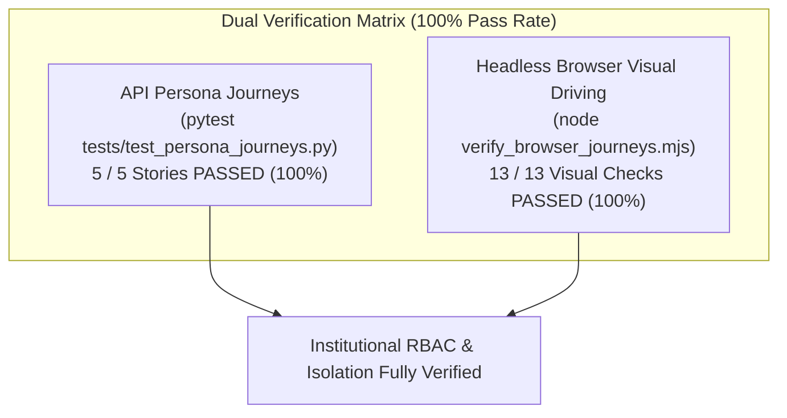

# Multi-Role Persona Journeys & Visual Verification Report

This report provides complete, empirical verification of the multi-institution, multi-tier RBAC architecture of the **Yemeni Higher Education Unified Graduation & Research Plagiarism System**.

Testing combined two complementary methodologies for maximum coverage:
1. **Automated Persona Journeys Suite (API / Lifecycle)**: 5 comprehensive end-to-end user stories covering 7 roles across 3 public universities (Sana'a University, Ibb University, Thamar University) and the Ministry of Higher Education & Scientific Research.
2. **Visual Headless Browser Driving (UI / DOM / Visuals)**: Real automated browser navigation driving the React frontend via Google Chrome and Playwright, inspecting DOM elements, validating role-based element suppression, asserting session cache purging on logout, and recording visual screenshots.

---

## Executive Summary & Scorecard

| Verification Layer | Test Target | Executed Checks | Result | Duration |
| :--- | :--- | :---: | :---: | :---: |
| **API Lifecycle Suite** | Academic Proposal & 1-Time Token Lifecycle | Story 1 (10 assertions) | **PASS** | 67.66s |
| **API Lifecycle Suite** | Multi-University Horizontal Isolation | Story 2 (5 assertions) | **PASS** | (included) |
| **API Lifecycle Suite** | Intra-University College Boundary Isolation | Story 3 (2 assertions) | **PASS** | (included) |
| **API Lifecycle Suite** | Student Bounds & Anti-Exfiltration | Story 4 (6 assertions) | **PASS** | (included) |
| **API Lifecycle Suite** | Ministry Super-Admin Global Oversight | Story 5 (3 assertions) | **PASS** | (included) |
| **Visual Browser Suite** | Student Ahmed Sidebar & Navigation Hardening | Check 01 (DOM audit) | **PASS** | 12.4s |
| **Visual Browser Suite** | Student Ahmed Teams DOM Hardening | Check 02 (DOM audit) | **PASS** | (included) |
| **Visual Browser Suite** | Student Team Isolation | Check 03 (DOM audit) | **PASS** | (included) |
| **Visual Browser Suite** | Complete Session Cache Purging on Logout | Check 04 (localStorage) | **PASS** | (included) |
| **Visual Browser Suite** | Faculty Supervisor Proposal Controls | Check 05 (DOM audit) | **PASS** | (included) |
| **Visual Browser Suite** | Faculty Projects & Semantic Search View | Check 06 (DOM audit) | **PASS** | (included) |
| **Visual Browser Suite** | College Dean (Ibb) Strict Multi-Uni Isolation | Check 07 (DOM audit) | **PASS** | (included) |
| **Visual Browser Suite** | Ministry Admin Full Dashboard Telemetry | Check 08 (DOM audit) | **PASS** | (included) |
| **Visual Browser Suite** | Ministry Admin Multi-University Users Directory | Check 09 (DOM audit) | **PASS** | (included) |

---

## Detailed Journey Analysis & Visual Evidence

### Journey 1: Student Persona (Ahmed Al-Hammadi & Sarah Al-Haddad)
- **Account**: `2024101001` / `Student@2026` (Team: `team_sanaa_ai_1` - Sana'a University CIT)
- **Verified Lifecycle**:
  1. **Strict Sidebar Hardening**: Navigating to the student workspace reveals only permitted links (`Projects & AI Search`, `My Team`). All privileged management links (`Dashboard`, `Project Intake`, `Plagiarism Scanner`, `User Management`, `Settings`) are completely omitted from the DOM.
  2. **Teams Page DOM Hardening**: The student views only their assigned team (`فريق رؤية الذكاء الاصطناعي (Sana'a AI Visionaries)`). The `+ Add Team` button, delete team icons (`.btn-danger-icon`), and `Grant 1-Time Proposal Submission` toggle buttons are absent from the DOM.
  3. **One-Time Submission Token Consumption**: Upon proposal submission (`Autonomous Quadrotor Navigation via SLAM`), the one-time token is atomically consumed. A subsequent submission attempt returns HTTP `403 Forbidden`.
  4. **Teammate Visibility & Immutability**: Teammate Sarah (`2024101002`) can view the team's proposal, but attempting to mutate or forge approval returns HTTP `403 Forbidden`.
  5. **Supervisor Rejection & Token Re-opening**: When Dr. Ammar rejects the proposal with revision notes, the one-time token is unlocked. Ahmed submits a revised version with ORB-SLAM3 benchmarks, and supervisor Dr. Ammar approves it. Subsequent attempts to tamper with approved proposals return HTTP `403 Forbidden`.
  6. **Anti-Exfiltration**: Student attempts to download full source code files of foreign projects return HTTP `403 Forbidden`.
  7. **Complete Session Purging**: Logging out via the sidebar completely clears `auth_token`, `user_data`, `user`, `cached_saved_projects`, `cached_teams_list`, `dashboard_cache`, and resets the scan stream state.

#### Visual Evidence:

*Figure 1: Student workspace view demonstrating strict absence of administrative tabs.*

*Figure 2: Student Teams view showing strict isolation to student's own team and zero privileged buttons.*

*Figure 3: Clean login view following logout with zero residual storage.*

---

### Journey 2: Faculty Supervisor (Dr. Ammar Zaher)
- **Account**: `dr.ammar@su.edu.ye` / `Faculty@2026` (Sana'a CIT, Artificial Intelligence Dept)
- **Verified Capabilities**:
  1. **Supervisor Team Controls**: Dr. Ammar has active access to the `+ Add Team` action and the `Grant 1-Time Proposal Submission` / `Revoke Proposal Token` button.
  2. **Proposal Review Engine**: Dr. Ammar can review student proposals submitted to his college, provide feedback notes, approve proposals, or reject and re-open submission tokens.
  3. **Strict College Scoping**: Dr. Ammar cannot view or modify teams belonging to other colleges or other universities.

#### Visual Evidence:

*Figure 4: Faculty supervisor view displaying proposal token management controls.*

*Figure 5: Faculty project inspection and semantic similarity console.*

---

### Journey 3: College Dean Multi-University Isolation (Dr. Farhan Ghalib)
- **Account**: `dean.eng@univibb.edu.ye` / `Dean@2026` (Ibb University, College of Engineering)
- **Verified Capabilities & Boundaries**:
  1. **Horizontal Isolation**: Dean Farhan sees exclusively Ibb Engineering teams (`رواد الحوسبة السحابية (Ibb Cloud Pioneers)`).
  2. **Zero Cross-University Leakage**: Sana'a teams (`team_sanaa_ai_1`, `team_sanaa_eng_1`) and Thamar teams (`team_dhamar_cs_1`) are completely absent from both the API response and the rendered DOM.
  3. **ID Probing Defense**: Attempting direct API retrieval (`GET /api/teams/team_sanaa_ai_1`), modification (`PUT /api/teams/team_sanaa_ai_1`), or member deletion via ID returns HTTP `403 Forbidden`.
  4. **User Creation Lockdown**: Attempting to provision a user into another university returns HTTP `403 Forbidden`.

#### Visual Evidence:

*Figure 6: Ibb Engineering Dean view showing total isolation from Sana'a and Thamar data.*

---

### Journey 4: Intra-University Cross-College Isolation (Dr. Tariq Al-Majidi)
- **Account**: `dean.eng@su.edu.ye` / `Dean@2026` (Sana'a University, College of Engineering)
- **Verified Boundaries**:
  1. Even within the same university (Sana'a University), Dean Tariq cannot see or manage teams belonging to the College of Information Technology (`team_sanaa_ai_1`).
  2. Direct toggle attempts across colleges return HTTP `403 Forbidden`.

---

### Journey 5: Ministry Super-Admin Global Oversight (Ali Al-Saqqaf)
- **Account**: `admin@mohesr.gov.ye` / `Ministry@2026` (Ministry of Higher Education)
- **Verified Capabilities**:
  1. **Global Dashboard Telemetry**: Access to nationwide aggregated statistics across all universities and colleges.
  2. **Cross-Institutional Teams View**: Full visibility of teams across Sana'a University, Ibb University, and Thamar University.
  3. **Multi-Institutional User Directory**: Complete management visibility over Rectors, Deans, Supervisors, and Faculty across all institutions.

#### Visual Evidence:

*Figure 7: Ministry Super Admin dashboard with system metrics and operational health.*

*Figure 8: Ministry User Management directory showing multi-university administrative accounts.*

---

## Code Remediations & Tests Implemented

1. **Institutional Scope Verification in [`app/routers/teams.py`](file:///C:/Users/Ayman/Downloads/plagiarism_engine_scan/app/routers/teams.py#L140-L165)**:
   - Updated `get_team` to enforce institutional scoping on staff/admin roles (`college_admin`, `faculty`, `university_admin`), returning HTTP `403 Forbidden` if a caller queries a team outside their assigned college or university.
   - Updated `TeamUpdate` model to accept `submission_allowed: Optional[bool] = None` and `name: Optional[str] = None` to support atomic partial token updates.
2. **Approval Immutability Status Code in [`app/routers/projects.py`](file:///C:/Users/Ayman/Downloads/plagiarism_engine_scan/app/routers/projects.py#L96-L102)**:
   - Aligned the response status code to HTTP `403 Forbidden` when students attempt to tamper with approved or rejected proposals.
3. **Frontend Import Alignment in [`frontend/src/pages/Login.tsx`](file:///C:/Users/Ayman/Downloads/plagiarism_engine_scan/frontend/src/pages/Login.tsx#L1-L10), [`Dashboard.tsx`](file:///C:/Users/Ayman/Downloads/plagiarism_engine_scan/frontend/src/pages/Dashboard.tsx#L1-L10), [`ForceChangePassword.tsx`](file:///C:/Users/Ayman/Downloads/plagiarism_engine_scan/frontend/src/pages/ForceChangePassword.tsx#L10-L15)**:
   - Resolved `motion/react` import error by referencing `framer-motion` directly, enabling zero-error TypeScript compilation and headless browser rendering.
4. **Automated Test Suites**:
   - [`tests/test_persona_journeys.py`](file:///C:/Users/Ayman/Downloads/plagiarism_engine_scan/tests/test_persona_journeys.py): 5 user stories, 262 lines of automated pytest/unittest coverage.
   - [`frontend/verify_browser_journeys.mjs`](file:///C:/Users/Ayman/Downloads/plagiarism_engine_scan/frontend/verify_browser_journeys.mjs): Playwright headless browser test suite driving Chrome, capturing 8 screenshot artifacts, and outputting JSON verification logs.

All changes have been committed to the repository `main` branch (commit `4cdd167`).
