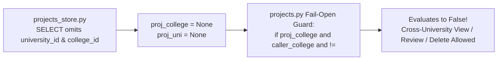

# Deep Technical & Security Audit Report

**Target Repository:** `C:\Users\Ayman\Downloads\plagiarism_engine_scan` (`main` @ commit `23e63f7`)  
**Audit Mode:** 100% Read-Only Static & Architectural Verification (zero files edited, zero database mutations)  
**Scope Covered:** Full FastAPI backend (`app/`), Plagiarism & Vector Engine (`plagiarism_engine/`), Database & Storage layers (`plagiarism_engine/db/`, `vectors/`, `storage/`), Seeding & Test suites (`scripts/`, `tests/`), and React/TypeScript Frontend (`frontend/src/`).

---

## 1. Executive Summary & Reality Check

While core workflows appear functional on the surface—and institutional scoping works partially on `/api/teams` and `/api/users` when happy-path seeded accounts are tested in fresh browser tabs—deep inspection uncovered **24 verified architectural, security, database, algorithmic, and UI bugs** (**7 Critical, 10 High, 7 Medium**).

> [!CAUTION]
> **Critical Discrepancy vs. Walkthrough Claims ([hierarchy_and_scoping_walkthrough.md](file:///C:/Users/Ayman/Downloads/plagiarism_engine_scan/hierarchy_and_scoping_walkthrough.md#L25-L32)):**  
> The walkthrough asserts that *"Proposals pending review are strictly scoped to the caller's college. Cross-college review or deletion attempts return 403 Forbidden"* (Scenario 2, Step 7). **In the actual code, institutional scoping on projects is 100% non-functional.** Both [`get_all_projects()`](file:///C:/Users/Ayman/Downloads/plagiarism_engine_scan/plagiarism_engine/db/projects_store.py#L124-L136) and [`get_project_by_id()`](file:///C:/Users/Ayman/Downloads/plagiarism_engine_scan/plagiarism_engine/db/projects_store.py#L184-L195) omit `university_id`, `college_id`, and `department_id` from their SQL `SELECT` statements. Every authorization check in [`projects.py`](file:///C:/Users/Ayman/Downloads/plagiarism_engine_scan/app/routers/projects.py#L44-L66) evaluates `None` against fail-open conditions (`if proj_college and caller_college and ...`), allowing **any faculty member or dean in any university to view, approve, reject, or delete proposals belonging to any other college or university nationwide.**

### Severity Matrix

| ID | Severity | Domain | Title | Primary Location |
| :--- | :--- | :--- | :--- | :--- |
| **F-1.1** | **CRITICAL** | RBAC / Scoping | Institutional project scoping is 100% inert (missing SQL columns + fail-open guards + NULL scanner IDs) | [projects_store.py](file:///C:/Users/Ayman/Downloads/plagiarism_engine_scan/plagiarism_engine/db/projects_store.py#L126), [projects.py](file:///C:/Users/Ayman/Downloads/plagiarism_engine_scan/app/routers/projects.py#L44-L66) |
| **F-1.2** | **CRITICAL** | RBAC / Authz | Self-scope privilege escalation (`PUT /api/users/{id}`) & unvalidated cross-college user injection | [users.py](file:///C:/Users/Ayman/Downloads/plagiarism_engine_scan/app/routers/users.py#L144-L156) |
| **F-2.1** | **CRITICAL** | DB Schema | Missing DDL columns (`submission_allowed`, `review_notes`, `submitted_by_student_id`) crash any fresh DB or wipe | [schema.py](file:///C:/Users/Ayman/Downloads/plagiarism_engine_scan/plagiarism_engine/db/schema.py#L28-L385) |
| **F-2.2** | **CRITICAL** | Auth / DB | Dual-table (`users` vs `students`) split-brain: deleted students still log in, missing `team_id`, invisible in search | [users.py](file:///C:/Users/Ayman/Downloads/plagiarism_engine_scan/app/routers/users.py#L195-L205), [users_store.py](file:///C:/Users/Ayman/Downloads/plagiarism_engine_scan/plagiarism_engine/db/users_store.py#L83-L95) |
| **F-2.4** | **CRITICAL** | Concurrency | Non-atomic unlocked `scan_history.json` truncates mid-read and wipes entire scan history to `[]` | [state.py](file:///C:/Users/Ayman/Downloads/plagiarism_engine_scan/app/state.py#L105-L118), [intake.py](file:///C:/Users/Ayman/Downloads/plagiarism_engine_scan/app/services/intake.py#L611-L614) |
| **F-4.1** | **CRITICAL** | Security | Git clone SSRF to internal hosts + symlink traversal enables **Arbitrary Host File Read** | [git_clone.py](file:///C:/Users/Ayman/Downloads/plagiarism_engine_scan/app/services/git_clone.py#L19-L50), [extractor.py](file:///C:/Users/Ayman/Downloads/plagiarism_engine_scan/plagiarism_engine/extractor.py#L221-L240) |
| **F-5.1** | **CRITICAL** | Frontend Security | Cross-user PII & institutional cache leak on logout / 401 (`localStorage` + module memory caches) | [Sidebar.tsx](file:///C:/Users/Ayman/Downloads/plagiarism_engine_scan/frontend/src/Sidebar.tsx#L144-L154), [useProjectsCache.ts](file:///C:/Users/Ayman/Downloads/plagiarism_engine_scan/frontend/src/lib/useProjectsCache.ts#L15-L55) |
| **F-1.3** | **HIGH** | RBAC / API | Widespread horizontal & role holes (`/files?include_content=true`, `/semantic-search`, `/teams`, global `project_name` collisions) | [projects.py](file:///C:/Users/Ayman/Downloads/plagiarism_engine_scan/app/routers/projects.py#L345), [teams.py](file:///C:/Users/Ayman/Downloads/plagiarism_engine_scan/app/routers/teams.py#L138-L325) |
| **F-2.3** | **HIGH** | Workflow | Teammates cannot view their own team's submitted proposal, status, or supervisor review notes | [projects.py](file:///C:/Users/Ayman/Downloads/plagiarism_engine_scan/app/routers/projects.py#L47-L49), [Projects.tsx](file:///C:/Users/Ayman/Downloads/plagiarism_engine_scan/frontend/src/pages/Projects.tsx#L227) |
| **F-2.5** | **HIGH** | DB / Vectors | Re-uploading a project retains stale embeddings & fingerprints; SQLite `INSERT OR REPLACE` wipes metadata | [projects_store.py](file:///C:/Users/Ayman/Downloads/plagiarism_engine_scan/plagiarism_engine/db/projects_store.py#L59-L72), [pgvector_store.py](file:///C:/Users/Ayman/Downloads/plagiarism_engine_scan/plagiarism_engine/vectors/pgvector_store.py#L391-L435) |
| **F-3.1** | **HIGH** | Engine Scoring | `/compare-direct-files` feeds uncalibrated raw cosine (`60–68% HIGH` false positives), blocks event loop, breaks `.doc`/fallback | [compare.py](file:///C:/Users/Ayman/Downloads/plagiarism_engine_scan/app/routers/compare.py#L275-L345) |
| **F-3.2** | **HIGH** | Engine Recall | Removed `vstore.get_pair_similarity` fallback drops restructured code outside global Top-5 to `~6% SAFE` | [intake.py](file:///C:/Users/Ayman/Downloads/plagiarism_engine_scan/app/services/intake.py#L493) |
| **F-5.2** | **HIGH** | Frontend UI | Containment badge multiplied by `100` twice (**`8500%`**) & cross-project `deepScanResultsCache` key collision | [ComparisonsTable.tsx](file:///C:/Users/Ayman/Downloads/plagiarism_engine_scan/frontend/src/pages/plagiarism/ComparisonsTable.tsx#L28-L29), [PlagiarismAnalysis.tsx](file:///C:/Users/Ayman/Downloads/plagiarism_engine_scan/frontend/src/pages/PlagiarismAnalysis.tsx#L116) |
| **F-5.3** | **HIGH** | Frontend Admin | `Users.tsx` omits `university_admin` & writes free-text strings into FK `college_id`; `Teams.tsx` shows `Members: 0` & leaks admin buttons | [Users.tsx](file:///C:/Users/Ayman/Downloads/plagiarism_engine_scan/frontend/src/pages/Users.tsx#L8-L13), [Teams.tsx](file:///C:/Users/Ayman/Downloads/plagiarism_engine_scan/frontend/src/pages/Teams.tsx#L174-L206) |
| **F-5.4** | **HIGH** | Frontend UI | Dashboard renders `CRITICAL` & `HIGH` verdicts in **emerald green**, has UTF-8 mojibake (`"—"`), & legacy thresholds | [Dashboard.tsx](file:///C:/Users/Ayman/Downloads/plagiarism_engine_scan/frontend/src/pages/Dashboard.tsx#L143-L148) |
| **F-6.1** | **HIGH** | Testing / DB | `test_rbac_hardening.py` mutates live DB and orphans seeded student `2024101001` (`team_id = NULL`) while skipping `/projects` | [test_rbac_hardening.py](file:///C:/Users/Ayman/Downloads/plagiarism_engine_scan/tests/test_rbac_hardening.py#L145-L232) |
| **F-4.2** | **HIGH** | Auth Security | `requires_password_change` unenforced on API & UI routes; default password `"123456"`; zero login rate limiting | [dependencies.py](file:///C:/Users/Ayman/Downloads/plagiarism_engine_scan/app/dependencies.py#L123-L128), [App.tsx](file:///C:/Users/Ayman/Downloads/plagiarism_engine_scan/frontend/src/App.tsx#L47-L60) |
| **F-2.6** | **MEDIUM** | SQLite Compat | Hardcoded PostgreSQL `%s` placeholders in raw router queries crash SQLite fallback mode | [auth.py](file:///C:/Users/Ayman/Downloads/plagiarism_engine_scan/app/routers/auth.py#L48-L65), [projects.py](file:///C:/Users/Ayman/Downloads/plagiarism_engine_scan/app/routers/projects.py#L471-L478) |
| **F-3.3** | **MEDIUM** | Performance | `_run_intake` logs *"Skipping Deep Semantic Indexing"* then runs it synchronously anyway; `_preload_models` wastes ~1 GB RAM | [intake.py](file:///C:/Users/Ayman/Downloads/plagiarism_engine_scan/app/services/intake.py#L99-L154), [state.py](file:///C:/Users/Ayman/Downloads/plagiarism_engine_scan/app/state.py#L30-L32) |
| **F-3.4** | **MEDIUM** | Search Quality | `semantic_search_projects` loads all vectors into Python RAM, ignores `embedding_model`/`is_scannable`, uses substring word match | [projects.py](file:///C:/Users/Ayman/Downloads/plagiarism_engine_scan/app/routers/projects.py#L413-L631) |
| **F-3.5** | **MEDIUM** | Analytics / Config | Dashboard reverses newest-first `scan_history` (showing 10 oldest scans & oldest verdicts); `Settings` thresholds are placebos | [dashboard.py](file:///C:/Users/Ayman/Downloads/plagiarism_engine_scan/app/routers/dashboard.py#L36-L59), [settings_store.py](file:///C:/Users/Ayman/Downloads/plagiarism_engine_scan/plagiarism_engine/db/settings_store.py#L18-L20) |
| **F-5.5** | **MEDIUM** | Frontend Auth | `/settings` route shown to `university_admin` (403 on Save) and hidden from `college_admin`; `/projects/check` blocks re-uploads | [App.tsx](file:///C:/Users/Ayman/Downloads/plagiarism_engine_scan/frontend/src/App.tsx#L142), [UploadSection.tsx](file:///C:/Users/Ayman/Downloads/plagiarism_engine_scan/frontend/src/pages/plagiarism/UploadSection.tsx#L298) |
| **F-5.6** | **MEDIUM** | Defaults / UX | Legacy `"Baghdad University"` hardcoded as fallback/default across backend proposal intake and 3 frontend pages | [projects.py](file:///C:/Users/Ayman/Downloads/plagiarism_engine_scan/app/routers/projects.py#L218), [UploadSection.tsx](file:///C:/Users/Ayman/Downloads/plagiarism_engine_scan/frontend/src/pages/plagiarism/UploadSection.tsx#L53-L55) |
| **F-4.3** | **MEDIUM** | Storage Security | `SupabaseStorage` lacks `..` path traversal normalization (`LocalStorage` has it) | [supabase_storage.py](file:///C:/Users/Ayman/Downloads/plagiarism_engine_scan/plagiarism_engine/storage/supabase_storage.py#L28-L45) |

---

## 2. Domain 1: Institutional Hierarchy & RBAC Breakdowns



### F-1.1 [CRITICAL] — Project Institutional Scoping is 100% Inert
- **Locations:**
  - [`ProjectsStoreMixin.get_all_projects`](file:///C:/Users/Ayman/Downloads/plagiarism_engine_scan/plagiarism_engine/db/projects_store.py#L124-L155)
  - [`ProjectsStoreMixin.get_project_by_id`](file:///C:/Users/Ayman/Downloads/plagiarism_engine_scan/plagiarism_engine/db/projects_store.py#L184-L211)
  - [`list_projects`](file:///C:/Users/Ayman/Downloads/plagiarism_engine_scan/app/routers/projects.py#L44-L66), [`review_proposal`](file:///C:/Users/Ayman/Downloads/plagiarism_engine_scan/app/routers/projects.py#L279-L289), [`delete_project`](file:///C:/Users/Ayman/Downloads/plagiarism_engine_scan/app/routers/projects.py#L322-L330)
  - [`_run_intake`](file:///C:/Users/Ayman/Downloads/plagiarism_engine_scan/app/services/intake.py#L71-L83), [`scanner.py`](file:///C:/Users/Ayman/Downloads/plagiarism_engine_scan/app/routers/scanner.py#L112-L444)
- **Root Cause (Three Compounding Bugs):**
  1. **Missing Columns in `SELECT`:** Both `get_all_projects()` and `get_project_by_id()` execute:
     ```sql
     SELECT id, name, title, abstract, team_id, department, year, university, status, created_at, student_id, review_notes, submitted_by_student_id FROM projects ...
     ```
     Neither query selects `university_id`, `college_id`, or `department_id`. Thus `item.get("college_id")` and `existing.get("university_id")` are **always `None`**.
  2. **Fail-Open Conditional Logic:** Every scope check in `projects.py` uses `if proj_college and caller_college and proj_college != caller_college:`. Whenever a project has `college_id = None` (or when `SELECT` omits it, or when an admin's scope column is unset), authorization silently **succeeds**.
  3. **Scanner / Intake Never Writes Hierarchy IDs:** None of the 5 upload/git endpoints in [`scanner.py`](file:///C:/Users/Ayman/Downloads/plagiarism_engine_scan/app/routers/scanner.py) pass the authenticated caller's `university_id`, `college_id`, or `department_id` into [`_run_intake`](file:///C:/Users/Ayman/Downloads/plagiarism_engine_scan/app/services/intake.py#L71-L83), leaving all saved projects with `NULL` institutional foreign keys in PostgreSQL.
- **Impact:** Any `faculty`, `college_admin`, or `university_admin` from Ibb or Thamar University can view pending proposals from Sana'a University, approve/reject them via `POST /api/plagiarism/projects/{id}/review`, and permanently delete projects (`college_admin`/`university_admin`) via `DELETE /api/plagiarism/projects/{id}`.

### F-1.2 [CRITICAL] — Self-Scope Escape & Cross-College User Injection
- **Locations:** [`update_user`](file:///C:/Users/Ayman/Downloads/plagiarism_engine_scan/app/routers/users.py#L330-L378), [`create_user`](file:///C:/Users/Ayman/Downloads/plagiarism_engine_scan/app/routers/users.py#L144-L157)
- **Root Cause:**
  1. In [`PUT /api/users/{user_id}`](file:///C:/Users/Ayman/Downloads/plagiarism_engine_scan/app/routers/users.py#L332-L369), self-modification only blocks changing `role` (`if user_id == current_user.get("user_id") and payload.role and payload.role != existing.get("role")`). It does **not** restrict `payload.university_id`, `payload.college_id`, or `payload.department_id`! A `college_admin` or `university_admin` can send `PUT /api/users/{their_own_id}` with `{"university_id": "uni_sanaa", "college_id": "col_sanaa_cit"}` and immediately hijack any institution in the country.
  2. Even when editing *other* users in [`PUT /api/users/{user_id}`](file:///C:/Users/Ayman/Downloads/plagiarism_engine_scan/app/routers/users.py#L345-L375), `college_admin` is never prevented from setting `payload.college_id = "col_sanaa_eng"` or `payload.university_id = "uni_sanaa"` on a user currently in their college.
  3. In [`POST /api/users`](file:///C:/Users/Ayman/Downloads/plagiarism_engine_scan/app/routers/users.py#L144-L156), when a `university_admin` creates a user, `payload.college_id` is never checked against `colleges.university_id == caller_uni`, allowing a university admin to plant a `college_admin` or `faculty` inside another university's college!

### F-1.3 [HIGH] — Widespread Endpoint Authorization & Isolation Gaps
Across the remaining routers, institutional boundaries and role restrictions have major holes:
1. **Nationwide Source Code Disclosure to Students ([`get_project_files`](file:///C:/Users/Ayman/Downloads/plagiarism_engine_scan/app/routers/projects.py#L345-L354)):** `GET /api/plagiarism/projects/{project_id}/files?include_content=true` uses `Depends(require_role())` (any logged-in user, including `student`) with zero ownership or institutional checks. Any student can download the complete source code of any project in the database.
2. **Confidential Proposal & Review Notes Leak in Semantic Search ([`semantic_search_projects`](file:///C:/Users/Ayman/Downloads/plagiarism_engine_scan/app/routers/projects.py#L413-L600)):** Accessible to all roles (`require_role()`), queries **all** rows in `projects` regardless of `status` (`pending_review`, `rejected`) or `university_id`/`college_id`, and returns `abstract` and confidential supervisor `review_notes` to students across all universities.
3. **Unscoped `PUT /api/plagiarism/projects/{id}` & Post-Approval Student Tampering ([`update_project`](file:///C:/Users/Ayman/Downloads/plagiarism_engine_scan/app/routers/projects.py#L85-L132)):**
   - Zero institutional scope check for `faculty`, `college_admin`, or `university_admin`.
   - Students can edit `title`, `abstract`, and `team_id` **even after** their proposal has been `approved` or `rejected`.
   - Line 98 checks `if payload.status and payload.status not in ("draft", "pending"):` — a naming mismatch with `"pending_review"`.
4. **Legacy Unscoped Approval Route ([`approve_project`](file:///C:/Users/Ayman/Downloads/plagiarism_engine_scan/app/routers/projects.py#L135-L157)):** `POST /api/plagiarism/projects/{project_id}/approve` has zero `college_id`/`university_id` checks.
5. **Broken Role Guard on Embedding Re-Index ([`index_project_embeddings`](file:///C:/Users/Ayman/Downloads/plagiarism_engine_scan/app/routers/projects.py#L357-L361)):** `require_role("ministry_admin", "college_admin", "faculty")` **excludes `"university_admin"`** (returning `403 Forbidden` to University Rectors!) and performs no institutional check.
6. **Unauthenticated Project Enumeration ([`check_project_exists`](file:///C:/Users/Ayman/Downloads/plagiarism_engine_scan/app/routers/projects.py#L394-L401)):** `GET /api/plagiarism/projects/check?name=...` has **no authentication dependency at all**.
7. **Team Router Scoping Gaps ([`teams.py`](file:///C:/Users/Ayman/Downloads/plagiarism_engine_scan/app/routers/teams.py)):**
   - [`get_team`](file:///C:/Users/Ayman/Downloads/plagiarism_engine_scan/app/routers/teams.py#L138-L153): Any student can fetch any team's details and members by ID (`if caller_role in ("college_admin", "faculty", "university_admin")` skips `student`).
   - [`update_team`](file:///C:/Users/Ayman/Downloads/plagiarism_engine_scan/app/routers/teams.py#L156-L189) & [`add_team_member`](file:///C:/Users/Ayman/Downloads/plagiarism_engine_scan/app/routers/teams.py#L269-L307): Enforce scope for `college_admin`/`faculty`, **completely omitting `university_admin`** (a Rector in Ibb can rename or add members to a team in Sana'a).
   - [`remove_team_member`](file:///C:/Users/Ayman/Downloads/plagiarism_engine_scan/app/routers/teams.py#L310-L325): Has **zero institutional scope checks** for any role (`faculty`/`college_admin`/`university_admin` can remove students from any team nationwide).
   - [`create_team`](file:///C:/Users/Ayman/Downloads/plagiarism_engine_scan/app/routers/teams.py#L113-L127): Allows `university_admin` to create a team without `college_id` (`college_id = None`), nor validates that `payload.college_id` belongs to `caller_uni`. If `college_id` is `None`, [`toggle_team_submission`](file:///C:/Users/Ayman/Downloads/plagiarism_engine_scan/app/routers/teams.py#L211-L215) and [`delete_team`](file:///C:/Users/Ayman/Downloads/plagiarism_engine_scan/app/routers/teams.py#L252-L256) look up `colleges WHERE id = None` and **permanently throw `403 Forbidden`**!
8. **Global `project_id = project_name` Collision Across Universities ([`intake.py`](file:///C:/Users/Ayman/Downloads/plagiarism_engine_scan/app/services/intake.py#L72), [`projects_store.py`](file:///C:/Users/Ayman/Downloads/plagiarism_engine_scan/plagiarism_engine/db/projects_store.py#L32-L74)):** When two instructors in different universities upload folders with a common name (e.g., `graduation_project`, `backend`, `smart_attendance`) with `save_to_db=true`, `project_id = project_name` collides on `projects.id` and **silently overwrites** the other university's files in `StorageService` and `project_files`!
9. **Unscoped Analytics, History & Comparison Endpoints:** [`dashboard.py`](file:///C:/Users/Ayman/Downloads/plagiarism_engine_scan/app/routers/dashboard.py), [`history.py`](file:///C:/Users/Ayman/Downloads/plagiarism_engine_scan/app/routers/history.py) (including `DELETE /api/plagiarism/history`, where any `college_admin` wipes scan history for the **entire country**), [`compare.py`](file:///C:/Users/Ayman/Downloads/plagiarism_engine_scan/app/routers/compare.py), and [`deep_scan.py`](file:///C:/Users/Ayman/Downloads/plagiarism_engine_scan/app/routers/deep_scan.py) have no institutional scoping.

---

## 3. Domain 2: Database Schema, Dual-Table Split-Brain & Concurrency Showstoppers

### F-2.1 [CRITICAL] — Missing Schema Columns Crash Every Fresh Install or Reset
- **Location:** [`SchemaMixin._init_schema`](file:///C:/Users/Ayman/Downloads/plagiarism_engine_scan/plagiarism_engine/db/schema.py#L28-L385)
- **Root Cause:** Three columns actively queried across `projects_store.py` and `teams_store.py` are **completely absent** from both `CREATE TABLE` (PostgreSQL & SQLite) and `alter_statements` in `schema.py`:
  1. `teams.submission_allowed BOOLEAN DEFAULT FALSE` (queried in [`teams_store.py`](file:///C:/Users/Ayman/Downloads/plagiarism_engine_scan/plagiarism_engine/db/teams_store.py#L51-L115) & [`seed_yemen_academic_hierarchy.py`](file:///C:/Users/Ayman/Downloads/plagiarism_engine_scan/scripts/seed_yemen_academic_hierarchy.py#L337))
  2. `projects.review_notes TEXT` (queried in [`projects_store.py`](file:///C:/Users/Ayman/Downloads/plagiarism_engine_scan/plagiarism_engine/db/projects_store.py#L126-L195))
  3. `projects.submitted_by_student_id TEXT` (queried in [`projects_store.py`](file:///C:/Users/Ayman/Downloads/plagiarism_engine_scan/plagiarism_engine/db/projects_store.py#L126-L195))
- **Impact:** They exist on the current dev machine **only** because of ad-hoc SQL run outside `schema.py`. Deploying to any new PostgreSQL database, running in SQLite mode, or calling [`wipe_all_data()`](file:///C:/Users/Ayman/Downloads/plagiarism_engine_scan/plagiarism_engine/db/projects_store.py#L496-L505) immediately crashes `/api/plagiarism/projects` and `/api/teams` with `psycopg2.errors.UndefinedColumn` / `sqlite3.OperationalError: no such column`.

### F-2.2 [CRITICAL] — Dual-Table (`users` vs `students`) Split-Brain Bugs
- **Locations:**
  - [`create_user`](file:///C:/Users/Ayman/Downloads/plagiarism_engine_scan/app/routers/users.py#L195-L205), [`bulk_import_students`](file:///C:/Users/Ayman/Downloads/plagiarism_engine_scan/app/routers/users.py#L254-L263), [`delete_user`](file:///C:/Users/Ayman/Downloads/plagiarism_engine_scan/app/routers/users.py#L424)
  - [`UsersStoreMixin.get_user_or_student_by_login`](file:///C:/Users/Ayman/Downloads/plagiarism_engine_scan/plagiarism_engine/db/users_store.py#L77-L98), [`create_student`](file:///C:/Users/Ayman/Downloads/plagiarism_engine_scan/plagiarism_engine/db/users_store.py#L211-L244), [`get_student_by_id`](file:///C:/Users/Ayman/Downloads/plagiarism_engine_scan/plagiarism_engine/db/users_store.py#L303-L318)
  - [`auth.py`](file:///C:/Users/Ayman/Downloads/plagiarism_engine_scan/app/routers/auth.py#L125-L216), [`search_students`](file:///C:/Users/Ayman/Downloads/plagiarism_engine_scan/app/routers/teams.py#L345-L365)
- **Root Cause & 5 Resulting Failures:**
  Seeded students (`seed_yemen_academic_hierarchy.py`) exist **only** in `students`. However, admin-created (`POST /api/users`) and CSV-imported (`POST /api/users/bulk-import`) students are written to **both** `students` AND `users` (with `users.email = enrollment_number`), while [`get_user_or_student_by_login`](file:///C:/Users/Ayman/Downloads/plagiarism_engine_scan/plagiarism_engine/db/users_store.py#L83-L95) queries `users` **first**!
  1. **Deleted Students Still Log In:** [`DELETE /api/users/{user_id}`](file:///C:/Users/Ayman/Downloads/plagiarism_engine_scan/app/routers/users.py#L424) calls `db.delete_user(user_id)` (which deletes **only** from `users`). Next time the deleted student logs in, `get_user_or_student_by_login` misses `users`, falls through to `students`, and **authenticates the deleted student**! Meanwhile, seeded students don't appear in `users` at all, so `DELETE /api/users/{seeded_student_id}` returns `404 User not found`!
  2. **Broken Student Session (`team_id` & `enrollment_number` Lost):** For any admin-created or CSV-imported student, `get_user_or_student_by_login` matches `users` first and sets `is_student = False`. Both `/api/auth/login` and `/api/auth/me` return `team_id = None` and `enrollment_number = None`, breaking the student's Team & Proposal UI!
  3. **Password Change Desynchronization:** [`POST /api/auth/change-password`](file:///C:/Users/Ayman/Downloads/plagiarism_engine_scan/app/routers/auth.py#L196-L212) checks `get_user_by_id` first and updates **only** `users.password_hash`, leaving `students.password_hash` and `students.requires_password_change` stale.
  4. **Admin-Created Students Invisible in Team Search:** [`db.create_student()`](file:///C:/Users/Ayman/Downloads/plagiarism_engine_scan/plagiarism_engine/db/users_store.py#L211-L244) only inserts `(id, name, enrollment_number, email, department, university, team_id, password_hash, requires_password_change)`—it **never writes `college_id`, `university_id`, or `department_id`**! Because [`GET /api/teams/students/search`](file:///C:/Users/Ayman/Downloads/plagiarism_engine_scan/app/routers/teams.py#L352-L357) filters `WHERE s.college_id = %s` / `WHERE s.university_id = %s`, **every student created via the Admin UI or CSV import is invisible to Deans, Faculty, and University Admins when building teams!**
  5. **Proposal Submission Loses `university_id` & `department_id`:** [`db.get_student_by_id()`](file:///C:/Users/Ayman/Downloads/plagiarism_engine_scan/plagiarism_engine/db/users_store.py#L303-L318) selects `college_id` but omits `university_id` and `department_id`. Thus [`student_submit_proposal`](file:///C:/Users/Ayman/Downloads/plagiarism_engine_scan/app/routers/projects.py#L230-L232) always writes `university_id = None` and `department_id = None` on submitted proposals!

### F-2.3 [HIGH] — Teammates Blinded to Their Own Team's Proposal
- **Locations:** [`list_projects`](file:///C:/Users/Ayman/Downloads/plagiarism_engine_scan/app/routers/projects.py#L47-L49), [`Projects.tsx`](file:///C:/Users/Ayman/Downloads/plagiarism_engine_scan/frontend/src/pages/Projects.tsx#L227)
- **Root Cause:** When Student 1 (`2024101001`, Ahmed) submits a team graduation proposal for `team_sanaa_ai_1`, `student_id` and `submitted_by_student_id` are set to Ahmed's ID. When his teammate Student 2 (`2024101002`, Sara) logs in:
  - Backend [`projects.py:48`](file:///C:/Users/Ayman/Downloads/plagiarism_engine_scan/app/routers/projects.py#L48) filters `if item.get("student_id") != caller_id and item.get("submitted_by_student_id") != caller_id: continue` (ignoring `item.get("team_id") == caller_team_id`).
  - Frontend [`Projects.tsx:227`](file:///C:/Users/Ayman/Downloads/plagiarism_engine_scan/frontend/src/pages/Projects.tsx#L227) also filters `if (isStudent && p.student_id !== user?.id) return false;`.
- **Impact:** Teammates cannot see their own team's submitted proposal, approval status, or supervisor feedback notes, and only see *"Submission Locked"* without explanation.

### F-2.4 [CRITICAL] — Non-Atomic, Unlocked `scan_history.json` Wipes History Under Concurrency
- **Locations:** [`_load_history` / `_save_history`](file:///C:/Users/Ayman/Downloads/plagiarism_engine_scan/app/state.py#L105-L118), [`_run_analysis`](file:///C:/Users/Ayman/Downloads/plagiarism_engine_scan/app/services/intake.py#L611-L614)
- **Root Cause:**
  - `_save_history()` calls `HISTORY_FILE.write_text(json.dumps(history, ...))` directly without a `threading.Lock` or atomic temp-file rename (`os.replace`). `Path.write_text` truncates `scan_history.json` to `0` bytes before writing.
  - If any user loads the Dashboard (`GET /api/dashboard/stats`) or History modal (`GET /api/plagiarism/history`) during the milliseconds `_save_history` is writing, `_load_history()` reads partial/empty JSON, catches `JSONDecodeError`, **renames `scan_history.json` to `.corrupt.<ts>.json` (or throws `PermissionError: [WinError 32]` on Windows), and resets scan history to `[]`!**
  - Two concurrent scans also suffer a classic Read-Modify-Write lost update (`intake.py:611-614`), and storing unbounded nested `comparisons` arrays inside a single JSON file parsed on every dashboard hit degrades linearly into multi-megabyte blocking I/O.

### F-2.5 [HIGH] — Stale Embeddings & Fingerprints on Re-Upload + SQLite Metadata Wipe
- **Locations:** [`ProjectsStoreMixin.save_project`](file:///C:/Users/Ayman/Downloads/plagiarism_engine_scan/plagiarism_engine/db/projects_store.py#L32-L74), [`PgVectorStore.get_reindex_plan`](file:///C:/Users/Ayman/Downloads/plagiarism_engine_scan/plagiarism_engine/vectors/pgvector_store.py#L391-L435), [`_run_intake`](file:///C:/Users/Ayman/Downloads/plagiarism_engine_scan/app/services/intake.py#L72-L120)
- **Root Cause:**
  1. When saving over an existing `project_id`, `save_project()` overwrites file bytes in `StorageService`, and executes:
     ```sql
     INSERT INTO project_files (id, project_id, relative_path, file_type, content)
     VALUES (%s, %s, %s, %s, %s)
     ON CONFLICT (id) DO UPDATE SET file_type = EXCLUDED.file_type, content = EXCLUDED.content;
     ```
     It **does NOT** nullify `embedding`, `embedding_binary`, or `embedding_model` on modified files, **does NOT** delete `project_files` rows for files removed in the new version, and `_run_intake` appends new fingerprints without calling `db.delete_project_fingerprints(project_id)` first! Consequently, [`get_reindex_plan`](file:///C:/Users/Ayman/Downloads/plagiarism_engine_scan/plagiarism_engine/vectors/pgvector_store.py#L419-L421) sees `has_vec = True` (`embedding IS NOT NULL`) and **skips re-embedding the updated code**!
  2. In SQLite mode ([`projects_store.py:67`](file:///C:/Users/Ayman/Downloads/plagiarism_engine_scan/plagiarism_engine/db/projects_store.py#L67)), `INSERT OR REPLACE INTO projects (id, name)` deletes the existing `projects` row and inserts a blank one, wiping `title`, `abstract`, `team_id`, `status`, `college_id`, and `university_id`.

### F-2.6 [MEDIUM] — Hardcoded PostgreSQL `%s` Placeholders Break SQLite Fallback
- **Locations:** [`auth.py`](file:///C:/Users/Ayman/Downloads/plagiarism_engine_scan/app/routers/auth.py#L48-L65), [`projects.py`](file:///C:/Users/Ayman/Downloads/plagiarism_engine_scan/app/routers/projects.py#L471-L478) (and L552–559), [`compare.py`](file:///C:/Users/Ayman/Downloads/plagiarism_engine_scan/app/routers/compare.py#L281)
- **Root Cause:** Raw SQL queries inside FastAPI routers bypass the DB store mixins and hardcode PostgreSQL `%s` parameter placeholders (plus PostgreSQL `::vector` casts in `projects.py:555`), raising `sqlite3.OperationalError: near "%": syntax error` whenever SQLite fallback mode is used.

---

## 4. Domain 3: Plagiarism Engine, Calibration & Scoring Regressions

### F-3.1 [HIGH] — `/compare-direct-files` Uncalibrated Cosine (`60–68% HIGH` False Positives), Event-Loop Blocking & Broken `.doc` / Base64 Handling
- **Location:** [`compare_direct_files`](file:///C:/Users/Ayman/Downloads/plagiarism_engine_scan/app/routers/compare.py#L261-L366)
- **Root Cause (Four Bugs in One Endpoint):**
  1. **Missing `calibrate_semantic()`:** Lines 326–334 compute raw cosine similarity $\cos(\mathbf{v}_1, \mathbf{v}_2)$ and pass it **directly** into `compute_fusion_score(winnowing_sim, ast_sim, semantic_score, ...)` without calling [`calibrate_semantic(raw_cosine, domain)`](file:///C:/Users/Ayman/Downloads/plagiarism_engine_scan/plagiarism_engine/fusion_scorer.py#L51-L82)! Dense multilingual/code encoders (`bge-m3` baseline `0.50`, `unixcoder-base` baseline `0.55`) produce `0.72–0.85` raw cosine on completely unrelated files. With $\alpha = 0.20$ (`0.80` semantic weight when lexical overlap is zero), **two completely unrelated essays or source files score `58%–68% (HIGH)`**!
  2. **Blocking `async def` Event Loop:** `compare_direct_files` is declared `async def` and calls `model.encode([content1, content2])`, `FileExtractor`, and DB queries **synchronously on the main Uvicorn event loop**, freezing all concurrent HTTP/SSE requests across the entire server during transformer inference.
  3. **Legacy `.doc` Binary Misread:** Line 305 checks `if ext in (".pdf", ".docx"):` and falls into `raw1.decode("utf-8", errors="ignore")` for `.doc` (`OLE2` binary), feeding binary garbage into the tokenizer instead of using `FileExtractor.extract_doc()`. It also skips `is_scannable()` validation on direct uploads.
  4. **Broken Fallback Decompression:** Line 288 checks `decompress_text(raw_c) if isinstance(raw_c, bytes) else raw_c`. However, `compress_text()` stores **base64-encoded ASCII `str`** (`"eJw..."`), NOT `bytes`! So `isinstance(raw_c, bytes)` is always `False`, and if `StorageService` misses, `compare_direct_files` compares raw base64 zlib ciphertext instead of source code!

### F-3.2 [HIGH] — Removed Pairwise Semantic Fallback Drops Restructured Code Outside Top-5
- **Location:** [`_run_analysis`](file:///C:/Users/Ayman/Downloads/plagiarism_engine_scan/app/services/intake.py#L489-L515)
- **Root Cause:** Previously, when a candidate pair `(u_path, target_pid, m_path)` surfaced via LSH/Winnowing or AST was not among the global Top-5 `vstore.query_file` matches across all 2,502 files in the corpus, `_run_analysis` called `vstore.get_pair_similarity(...)` to compute exact calibrated semantic similarity for that pair. At [`intake.py:493`](file:///C:/Users/Ayman/Downloads/plagiarism_engine_scan/app/services/intake.py#L493), this fallback was removed:
  ```python
  semantic_score = semantic_lookup.get((u_path, target_pid, m_path), 0.0)
  ```
- **Impact:** In a large multi-university corpus where boilerplate or utility files from other projects occupy the global Top-5 ANN slots, a genuinely plagiarized/restructured file ranked #6 in ANN gets `semantic_score = 0.0`. Inside [`compute_fusion_score`](file:///C:/Users/Ayman/Downloads/plagiarism_engine_scan/plagiarism_engine/fusion_scorer.py#L118-L120), `semantic == 0.0` forces $\alpha = 1.0$ (disabling semantic weight completely), collapsing a `75% CRITICAL` restructured-code match down to `~6% SAFE`.

### F-3.3 [MEDIUM] — Contradictory Synchronous Indexing in `_run_intake` & Wasted ~1 GB Model Preload
- **Locations:** [`_run_intake`](file:///C:/Users/Ayman/Downloads/plagiarism_engine_scan/app/services/intake.py#L99-L154), [`_preload_models`](file:///C:/Users/Ayman/Downloads/plagiarism_engine_scan/app/state.py#L30-L32)
- **Root Cause:**
  1. [`intake.py:99`](file:///C:/Users/Ayman/Downloads/plagiarism_engine_scan/app/services/intake.py#L99) logs `"[INTAKE] Skipping Deep Semantic Indexing (Instant Mode enabled)..."`, yet lines 146–154 immediately call `_index_project_embeddings(project_id, processed_files, log_callback)` synchronously during project intake!
  2. [`state.py:31`](file:///C:/Users/Ayman/Downloads/plagiarism_engine_scan/app/state.py#L31) preloads `("code", "multilingual", "minilm")` at startup. `"code"` loads `microsoft/codebert-base` (~500 MB) and `"minilm"` loads `all-MiniLM-L6-v2` (~100 MB), while the actual engine uses `"unixcoder"` (`microsoft/unixcoder-base`, per [`DOMAIN_MODEL_KEYS`](file:///C:/Users/Ayman/Downloads/plagiarism_engine_scan/plagiarism_engine/config.py#L51-L54)). Result: ~600 MB of unused weights stay pinned in RAM forever, while the first code scan still suffers a cold-load stall downloading/loading `unixcoder-base`!

### F-3.4 [MEDIUM] — `semantic_search_projects` In-Memory Full Scan & Substring Lexical Noise
- **Location:** [`semantic_search_projects`](file:///C:/Users/Ayman/Downloads/plagiarism_engine_scan/app/routers/projects.py#L413-L631)
- **Root Cause:**
  1. Instead of using `pgvector` HNSW (`<=>`) in SQL, lines 441–514 `SELECT abstract_embedding` and `SELECT embedding FROM project_files` for **every project and file in PostgreSQL**, parse vector strings in Python loops, and run brute-force NumPy dot products in RAM.
  2. It ignores `embedding_model` provenance and `is_scannable(relative_path)` when scanning `project_files`, comparing `bge-m3` query vectors against `unixcoder-base` or legacy `minilm` vectors of incompatible latent spaces (if both happen to share 768 dims, e.g., `codebert` vs `unixcoder`, or skipping 1024-dim `bge-m3` vs 768-dim `unixcoder`).
  3. Line 525 checks lexical overlap via substring `w in norm_corpus` instead of token boundaries: searching `"ai"` matches `"main"`, `"domain"`, `"email"`, and `"container"`, bypassing the `0.50x` zero-lexical-overlap damper!

### F-3.5 [MEDIUM] — Reversed Dashboard History & Disconnected Placebo Settings
- **Locations:** [`get_dashboard_stats`](file:///C:/Users/Ayman/Downloads/plagiarism_engine_scan/app/routers/dashboard.py#L36-L59), [`SettingsStoreMixin`](file:///C:/Users/Ayman/Downloads/plagiarism_engine_scan/plagiarism_engine/db/settings_store.py#L18-L20), [`Settings.tsx`](file:///C:/Users/Ayman/Downloads/plagiarism_engine_scan/frontend/src/pages/Settings.tsx#L84-L122)
- **Root Cause:**
  1. [`intake.py:613`](file:///C:/Users/Ayman/Downloads/plagiarism_engine_scan/app/services/intake.py#L613) inserts newest scans at index `0` (`history.insert(0, history_entry)`). Yet [`dashboard.py:36`](file:///C:/Users/Ayman/Downloads/plagiarism_engine_scan/app/routers/dashboard.py#L36) slices `recent = history[::-1][:10]` (returning the **10 oldest** scans ever recorded!), and lines 56–59 iterate `for h in history:` overwriting `latest_by_project[pname] = h`, so the KPI cards (`Flagged`, `Clean`, `Review`) count each project's **first/oldest** scan instead of its latest scan!
  2. `Settings.tsx` allows admins to configure `similarity_threshold` (default `70%`) and `max_upload_size_mb` (default `50 MB`) and saves them to the `settings` table, **but zero functions in `scanner.py`, `intake.py`, or `fusion_scorer.py` ever read `db.get_settings()`** (`fusion_scorer.py` hardcodes `70/50/30` and `scanner.py` has no upload size cap).

---

## 5. Domain 4: Backend Security & Operational Vulnerabilities

### F-4.1 [CRITICAL] — Git Clone SSRF, Credential Hang & Symlink Arbitrary Host File Read
- **Locations:** [`_clone_git_repo`](file:///C:/Users/Ayman/Downloads/plagiarism_engine_scan/app/services/git_clone.py#L19-L50), [`FileExtractor.scan_project_directory`](file:///C:/Users/Ayman/Downloads/plagiarism_engine_scan/plagiarism_engine/extractor.py#L221-L240), [`SupabaseStorage`](file:///C:/Users/Ayman/Downloads/plagiarism_engine_scan/plagiarism_engine/storage/supabase_storage.py#L28-L45)
- **Root Cause:**
  1. **Arbitrary Host File Read via Git Symlinks:** `_clone_git_repo` runs `git clone --depth 1` without `-c core.symlinks=false`. In [`FileExtractor.scan_project_directory`](file:///C:/Users/Ayman/Downloads/plagiarism_engine_scan/plagiarism_engine/extractor.py#L221-L237), `os.walk(root_dir)` defaults to `followlinks=False` for *directories*, **but file symlinks appear in `files`**, and `open(full_path, ...)` follows them! A malicious Git repository containing `src/exploit.py -> /etc/passwd` or `C:\Users\...\plagiarism_engine_scan\.env` (if renamed `.py`) causes the server to extract, store, and serve the host's sensitive file back to the attacker via `/api/plagiarism/projects/{id}/files?include_content=true` or `/api/plagiarism/compare`!
  2. **SSRF to Internal Services:** `_clone_git_repo` only checks `url.startswith("https://")` and blocks shell metacharacters. It does **not** restrict allowed hosts (e.g., `github.com`, `gitlab.com`, `bitbucket.org`) or block RFC1918/loopback/cloud-metadata IPs (`https://127.0.0.1:...`, `https://10.x.x.x/...`, or HTTP 302 redirects from an external HTTPS server to `http://169.254.169.254/`).
  3. **120-Second Worker Hang:** `subprocess.run(["git", "clone", ...])` does not pass `env={**os.environ, "GIT_TERMINAL_PROMPT": "0"}`, causing private/deleted repos to hang on a credential prompt until the 120s timeout expires.
  4. **`SupabaseStorage` Path Traversal:** Unlike [`LocalStorage._resolve_path`](file:///C:/Users/Ayman/Downloads/plagiarism_engine_scan/plagiarism_engine/storage/local_storage.py#L20-L26), [`SupabaseStorage`](file:///C:/Users/Ayman/Downloads/plagiarism_engine_scan/plagiarism_engine/storage/supabase_storage.py#L28-L45) only calls `path.lstrip("/")` without rejecting `..` segments.

### F-4.2 [HIGH] — Unenforced `requires_password_change`, Weak `"123456"` Default & No Rate Limiting
- **Locations:** [`require_role`](file:///C:/Users/Ayman/Downloads/plagiarism_engine_scan/app/dependencies.py#L123-L128), [`ProtectedRoute`](file:///C:/Users/Ayman/Downloads/plagiarism_engine_scan/frontend/src/App.tsx#L47-L60), [`users.py`](file:///C:/Users/Ayman/Downloads/plagiarism_engine_scan/app/routers/users.py#L163), [`auth.py`](file:///C:/Users/Ayman/Downloads/plagiarism_engine_scan/app/routers/auth.py#L125-L185)
- **Root Cause:**
  1. When `requires_password_change = True`, `Login.tsx` redirects to `/force-change-password`, **but neither `ProtectedRoute` (`App.tsx`) nor `require_role` (`dependencies.py`) checks the flag**. Simply typing `/dashboard` or `/projects` in the URL bar—or calling the API directly—completely bypasses forced password rotation!
  2. Admin-created and bulk-imported students default to password `"123456"` ([`users.py:163,234`](file:///C:/Users/Ayman/Downloads/plagiarism_engine_scan/app/routers/users.py#L163)), predictable from sequential `enrollment_number` IDs (`2024101001`, `2024101002`), and `/api/auth/login` has **zero brute-force rate limiting**.

---

## 6. Domain 5: Frontend Caching, Cross-User Leaks & UI/UX Defects

### F-5.1 [CRITICAL] — Cross-User PII & Institutional Cache Leak on Logout / Account Switch
- **Locations:**
  - [`Sidebar.tsx`](file:///C:/Users/Ayman/Downloads/plagiarism_engine_scan/frontend/src/Sidebar.tsx#L144-L154), [`api.ts`](file:///C:/Users/Ayman/Downloads/plagiarism_engine_scan/frontend/src/lib/api.ts#L83-L87)
  - [`useProjectsCache.ts`](file:///C:/Users/Ayman/Downloads/plagiarism_engine_scan/frontend/src/lib/useProjectsCache.ts#L15-L55), [`useTeamsCache.ts`](file:///C:/Users/Ayman/Downloads/plagiarism_engine_scan/frontend/src/lib/useTeamsCache.ts#L15-L55), [`useUsersCache.ts`](file:///C:/Users/Ayman/Downloads/plagiarism_engine_scan/frontend/src/lib/useUsersCache.ts#L15-L60), [`Dashboard.tsx`](file:///C:/Users/Ayman/Downloads/plagiarism_engine_scan/frontend/src/pages/Dashboard.tsx#L18-L39)
- **Root Cause:** `Sidebar.tsx` (`handleLogout`) only removes `auth_token`, `auth_user`, and `plagiarism-scan-storage`. It **never clears**:
  - `localStorage` keys: `cached_saved_projects`, `cached_teams_list`, `cached_users_*`, `cached_dashboard_stats`, `deepScanResultsCache`
  - Module-level JS singletons: `memoryCache` in `useProjectsCache.ts`, `useTeamsCache.ts`, and `useUsersCache.ts`!
- **Reproduction:** Log in as Sana'a University Rector (`rector@su.edu.ye`), visit `/users` and `/teams`, click **Log out**, and immediately log in as Ibb University Dean (`dean.eng@univibb.edu.ye`) within 10 seconds (`STALE_TIME_MS = 10_000`). Because SPA navigation (`navigate("/dashboard")`) keeps JS module memory alive and `Date.now() - lastFetchedAt < 10_000`, **Ibb's Dean is immediately shown Sana'a University's confidential users, teams, and projects without even hitting the network** (and even after 10s, flashes Sana'a's data from `memoryCache`/`localStorage` until the background fetch completes, or keeps it indefinitely if offline/403)!

### F-5.2 [HIGH] — `8500%` Containment Score Bug & Cross-Project `deepScanResultsCache` Collision
- **Locations:** [`ComparisonsTable.tsx`](file:///C:/Users/Ayman/Downloads/plagiarism_engine_scan/frontend/src/pages/plagiarism/ComparisonsTable.tsx#L28-L29) (and L186), [`PlagiarismAnalysis.tsx`](file:///C:/Users/Ayman/Downloads/plagiarism_engine_scan/frontend/src/pages/PlagiarismAnalysis.tsx#L116)
- **Root Cause:**
  1. **Double `* 100` Multiplication:** [`fusion_scorer.py:140`](file:///C:/Users/Ayman/Downloads/plagiarism_engine_scan/plagiarism_engine/fusion_scorer.py#L140) already returns `containment_score` scaled to `0..100` (`round(containment * 100, 1)`). Yet [`ComparisonsTable.tsx:28-29`](file:///C:/Users/Ayman/Downloads/plagiarism_engine_scan/frontend/src/pages/plagiarism/ComparisonsTable.tsx#L28-L29) computes:
     ```ts
     const containment = typeof comp.containment_score === 'number' ? Math.round(comp.containment_score * 100) : null;
     ```
     and renders `{containment}% contained` at line 161—displaying **`8500% contained`** or **`10000% contained`** whenever subset containment triggers (`> 0.30`)!
  2. **Cross-Project Cache Key Collision:** `deepScanResultsCache` keys AI verification results by `` `${file1}::${file2}` `` (omitting `scannedProject` and `matchedProject`) and persists them forever in `localStorage`. Running AI Deep Verify on `src/main.py::src/main.py` in Project A permanently displays Project A's cached AI similarity score when inspecting two completely different `src/main.py` files in Project B!

### F-5.3 [HIGH] — Broken User & Team Management UIs
- **Locations:** [`Users.tsx`](file:///C:/Users/Ayman/Downloads/plagiarism_engine_scan/frontend/src/pages/Users.tsx#L8-L13) (and L439–512), [`Teams.tsx`](file:///C:/Users/Ayman/Downloads/plagiarism_engine_scan/frontend/src/pages/Teams.tsx#L174-L206) (and L308–423)
- **Root Cause:**
  1. **`Users.tsx` Cannot Create `university_admin` & Corrupts `college_id` Foreign Keys:**
     - `ROLES` (`Users.tsx:8-13`) only lists `ministry_admin`, `college_admin`, `faculty`, `student`—making it **impossible** for the Ministry Admin to create a `university_admin` via the UI, and rendering raw unstyled role strings for existing University Rectors.
     - Lines 491–498 use a free-text `<input placeholder="e.g. College of Engineering">` bound directly to `form.college_id` (and provide **no** `university_id` selector for staff!). Typing `"College of Engineering"` stores that literal string instead of FK `'col_sanaa_eng'`, breaking every SQL join and institutional scope filter for that user!
     - There is no **Edit User** modal anywhere in `Users.tsx` despite `PUT /api/users/{id}` existing on the backend.
  2. **`Teams.tsx` Always Displays `Members: 0` & Exposes Admin Controls to Students:**
     - [`teams_store.py:51-95`](file:///C:/Users/Ayman/Downloads/plagiarism_engine_scan/plagiarism_engine/db/teams_store.py#L51-L95) (`get_all_teams`) does not populate `members` (or `member_count`), so `team.members?.length || 0` in [`Teams.tsx:206`](file:///C:/Users/Ayman/Downloads/plagiarism_engine_scan/frontend/src/pages/Teams.tsx#L206) **always displays `0` on every team card** until clicked!
     - In [`Teams.tsx`](file:///C:/Users/Ayman/Downloads/plagiarism_engine_scan/frontend/src/pages/Teams.tsx#L174), `+ Add Team` (L174), the student search/add bar (L384–411), and member remove `X` buttons (L416) are **not hidden for `student` role**, letting students click admin buttons that fail with `403` errors.

### F-5.4 [HIGH] — Inverted Green `CRITICAL`/`HIGH` Badges on Dashboard, Mojibake & Threshold Drift
- **Locations:** [`Dashboard.tsx`](file:///C:/Users/Ayman/Downloads/plagiarism_engine_scan/frontend/src/pages/Dashboard.tsx#L143-L148) (and L251, L266), [`PlagiarismAnalysis.tsx`](file:///C:/Users/Ayman/Downloads/plagiarism_engine_scan/frontend/src/pages/PlagiarismAnalysis.tsx#L742-L747), [`ScanHistoryModal.tsx`](file:///C:/Users/Ayman/Downloads/plagiarism_engine_scan/frontend/src/pages/plagiarism/ScanHistoryModal.tsx#L50) (and L247)
- **Root Cause:**
  1. **Critical Plagiarism Shown in Emerald Green:** The engine emits verdicts `"CRITICAL"`, `"HIGH"`, `"LOW"`, `"SAFE"` ([`fusion_scorer.py:21-33`](file:///C:/Users/Ayman/Downloads/plagiarism_engine_scan/plagiarism_engine/fusion_scorer.py#L21-L33)). However, [`Dashboard.tsx:143-148`](file:///C:/Users/Ayman/Downloads/plagiarism_engine_scan/frontend/src/pages/Dashboard.tsx#L143-L148) checks legacy strings:
     ```ts
     const verdictBadge = (verdict: string) => {
       if (verdict === "FLAGGED") return "bg-danger/10 text-danger ...";
       if (verdict === "REVIEW" || verdict === "WARNING") return "bg-warning/10 text-warning ...";
       return "bg-emerald-500/10 text-emerald-500 border-emerald-500/20";
     };
     ```
     Every `"CRITICAL"` and `"HIGH"` scan in the Dashboard's Recent Scans table falls into the default branch and renders with a **green safe badge**!
  2. **UTF-8 Mojibake & Broken 7-in-6 Grid:** [`Dashboard.tsx:251`](file:///C:/Users/Ayman/Downloads/plagiarism_engine_scan/frontend/src/pages/Dashboard.tsx#L251) renders literal `"—"` instead of `"—"`, and line 266 places **7** KPI stat cards inside `xl:grid-cols-6`, wrapping the 7th card onto an orphaned second row.
  3. **Inconsistent Thresholds Across Views:** Engine verdicts use `70 / 50 / 30`, whereas [`PlagiarismAnalysis.tsx:742-747`](file:///C:/Users/Ayman/Downloads/plagiarism_engine_scan/frontend/src/pages/PlagiarismAnalysis.tsx#L742-L747) colors file scores using `85 / 65 / 40`, and [`ScanHistoryModal.tsx:50,247`](file:///C:/Users/Ayman/Downloads/plagiarism_engine_scan/frontend/src/pages/plagiarism/ScanHistoryModal.tsx#L50) uses `65 / 25`.

### F-5.5 [MEDIUM] — `/settings` Role Mismatch & `/projects/check` Blocking Re-Uploads
- **Locations:** [`App.tsx`](file:///C:/Users/Ayman/Downloads/plagiarism_engine_scan/frontend/src/App.tsx#L142), [`Sidebar.tsx`](file:///C:/Users/Ayman/Downloads/plagiarism_engine_scan/frontend/src/Sidebar.tsx#L54), [`settings.py`](file:///C:/Users/Ayman/Downloads/plagiarism_engine_scan/app/routers/settings.py#L14-L20), [`UploadSection.tsx`](file:///C:/Users/Ayman/Downloads/plagiarism_engine_scan/frontend/src/pages/plagiarism/UploadSection.tsx#L298-L307)
- **Root Cause:**
  1. `Sidebar.tsx` and `App.tsx` grant `/settings` access to `["ministry_admin", "university_admin"]`, while `PUT /api/settings` (`settings.py:20`) allows **only** `"ministry_admin"` (so University Rectors get `403 Forbidden` when clicking Save), and `GET /api/settings` (`settings.py:14`) allows `college_admin` (whom `App.tsx` blocks!).
  2. `UploadSection.tsx:298` calls `fetch('/api/plagiarism/projects/check?...')` without an `Authorization` header and hard-aborts upload whenever `data.exists` is true, preventing staff from updating an existing project's codebase unless they manually rename it.

### F-5.6 [MEDIUM] — Legacy `"Baghdad University"` Defaults in Yemeni Hierarchy System
- **Locations:** [`projects.py:218`](file:///C:/Users/Ayman/Downloads/plagiarism_engine_scan/app/routers/projects.py#L218), [`UploadSection.tsx:53,55`](file:///C:/Users/Ayman/Downloads/plagiarism_engine_scan/frontend/src/pages/plagiarism/UploadSection.tsx#L53-L55), [`Projects.tsx:537`](file:///C:/Users/Ayman/Downloads/plagiarism_engine_scan/frontend/src/pages/Projects.tsx#L537), [`Users.tsx:186,453`](file:///C:/Users/Ayman/Downloads/plagiarism_engine_scan/frontend/src/pages/Users.tsx#L186)
- **Root Cause:** Despite migrating to the Yemeni Ministry of Higher Education hierarchy (Sana'a, Ibb, Thamar), hardcoded `"Baghdad University"` defaults remain in `ProposalSubmit.university` (`projects.py:218`), `UploadSection.tsx` initial state (`useState("Baghdad University")`), `Projects.tsx` edit modal placeholder, and `Users.tsx` CSV template/placeholders.

---

## 7. Domain 6: Test Suite Blind Spots & Live-Database Corruption

### F-6.1 [HIGH] — `test_rbac_hardening.py` Mutates & Corrupts the Live Database
- **Location:** [`tests/test_rbac_hardening.py`](file:///C:/Users/Ayman/Downloads/plagiarism_engine_scan/tests/test_rbac_hardening.py#L145-L319)
- **Root Cause:**
  1. **Orphaned Seeded Student in Live DB:** `test_supervisor_one_time_submission_workflow` (lines 152–232) runs directly against the live PostgreSQL database (`get_db()`). At line 162, it reassigns seeded student **`std_2024101001` (`Ahmed Al-Hammadi`)** from `team_sanaa_ai_1` to a temporary `test_team_...`. In its `finally:` block (line 232), it calls `DELETE /api/teams/{team_id}`, which sets `students.team_id = NULL`—**never restoring Ahmed back to `team_sanaa_ai_1`**! It also leaves two `"Quadrotor SLAM Navigation Proposal"` test rows permanently in `projects`.
  2. **Zero Coverage of `/api/plagiarism/projects` Isolation:** `test_institutional_scoping_and_cross_university_isolation` (lines 250–319) tests `/api/teams` and `/api/users`, **never calling `/api/plagiarism/projects`**—which is why **F-1.1** passed undetected!
  3. **Zero Negative-Control Calibration Test:** `test_direct_pair_comparison_semantic_and_paths` (lines 233–249) only tests near-identical strings (`assert sim > 0`), never testing two **unrelated** files—which is why **F-3.1** (`60–68% HIGH` false positive on unrelated files) passed undetected!

---

## 8. Recommended Phased Remediation Roadmap

> [!IMPORTANT]
> To preserve stability and allow you to verify each milestone before moving on, fixes should be executed in **5 clean, isolated phases**:

1. **Phase 1 — Database Schema, Dual-Table Unification & Atomic History:**
   - Add `teams.submission_allowed`, `projects.review_notes`, and `projects.submitted_by_student_id` to [`schema.py`](file:///C:/Users/Ayman/Downloads/plagiarism_engine_scan/plagiarism_engine/db/schema.py) (`CREATE TABLE` + idempotent `ALTER TABLE`).
   - Eliminate the `users` vs `students` split-brain (keep students exclusively in `students` or synchronize CRUD/password/hierarchy fields across `create_student`, `get_student_by_id`, and `delete_user`), fix SQLite `%s` queries, and wrap `scan_history.json` in a `threading.Lock` + atomic temp-file `os.replace`.
   - Repair seeded student `std_2024101001` (`team_id = 'team_sanaa_ai_1'`) and isolate tests from the live DB.
2. **Phase 2 — Strict Institutional Hierarchy & RBAC Enforcement:**
   - Include `university_id`, `college_id`, `department_id` in `get_all_projects()` and `get_project_by_id()`; convert fail-open guards to strict scope helpers; stamp caller institutional IDs on all scanner/intake uploads; scope project IDs per institution (or UUID + display `name`).
   - Allow teammates (`team_id`) to view their own team's proposal (`projects.py` & `Projects.tsx`).
   - Close self-scope escape & cross-college injection in `users.py`, lock down `/files?include_content=true`, `/semantic-search`, `/projects/{id}`, `/index-embeddings`, `/projects/check`, and fix the 4 scoping gaps in `teams.py`.
3. **Phase 3 — Plagiarism Engine Calibration, Re-Upload Integrity & Performance:**
   - Apply `calibrate_semantic()` in `compare_direct_files`, offload blocking work to `run_in_executor`, support `.doc` via `FileExtractor`, and fix `str` vs `bytes` decompression fallback.
   - Restore pairwise semantic lookup (`vstore.get_pair_similarity`) for candidate pairs outside global Top-5; invalidate stale embeddings & old fingerprints when re-uploading a project; fix `_preload_models` (`unixcoder` instead of `codebert`/`minilm`) and `_run_intake` double-indexing.
   - Fix `dashboard.py` double-reversed history & connect or remove placebo `Settings`.
4. **Phase 4 — Backend Security Hardening (Git SSRF, Symlinks & Auth):**
   - Reject symlinks (`os.path.islink`) in `FileExtractor.scan_project_directory`, pass `-c core.symlinks=false` and `GIT_TERMINAL_PROMPT=0` to `git clone`, validate public Git hostnames/IPs, enforce `requires_password_change` in `dependencies.py` & `App.tsx`, and add login rate limiting.
5. **Phase 5 — Frontend Cache Isolation & UI/UX Polish:**
   - Purge all `cached_*` `localStorage` keys and reset all module `memoryCache` stores on logout and `401`.
   - Fix `ComparisonsTable.tsx` `containment_score` (`8500%` $\rightarrow$ `85%`), include project IDs in `deepScanResultsCache`, fix `Dashboard.tsx` green `CRITICAL`/`HIGH` badges & `"—"` mojibake, add `university_admin` + University/College dropdowns to `Users.tsx`, show real member counts + hide admin controls for students in `Teams.tsx`, and replace `"Baghdad University"` remnants with Yemeni institutional defaults.
