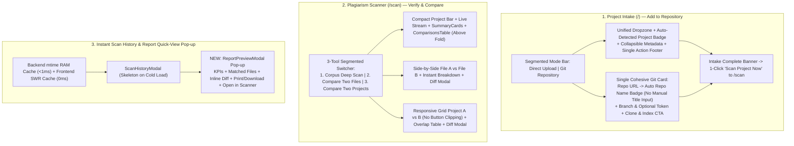

# UI Polish, Workflow Organization, Localization & Theme Implementation Plan

## 1. Root-Cause Investigation Summary

Before designing any change, every issue reported (and visible in your 5 screenshots) was traced to its exact root cause in the codebase (`HEAD` @ `4cdd167`):

| Reported Issue | Exact Root Cause Found in Codebase |
| :--- | :--- |
| **1. Clicking `"Scan History"` is slow every single time** (Screenshot 4) | [`data/scan_history.json`](file:///C:/Users/Ayman/Downloads/plagiarism_engine_scan/app/state.py#L102-L125) has grown to **20.01 MB** (`20,009,619` bytes). Every click calls [`GET /api/plagiarism/history`](file:///C:/Users/Ayman/Downloads/plagiarism_engine_scan/app/routers/history.py#L48-L52), which runs `_load_history()` synchronously on FastAPI's event loop—reading and `json.loads()`-ing all 20 MB from disk on every click—while [`ScanHistoryModal.tsx`](file:///C:/Users/Ayman/Downloads/plagiarism_engine_scan/frontend/src/pages/plagiarism/ScanHistoryModal.tsx#L90-L108) keeps zero client cache and re-fetches from scratch every time it opens. |
| **2. Clicking `"Inspect"` says `"Loaded report..."` but nothing appears (and Screenshot 2 shows `%` with no number!)** | **Two bugs:** (a) [`ScanHistoryModal.tsx`](file:///C:/Users/Ayman/Downloads/plagiarism_engine_scan/frontend/src/pages/plagiarism/ScanHistoryModal.tsx#L136-L148) closes the modal and writes to `scanStore.scanResult`, which renders at the **very bottom** of [`PlagiarismAnalysis.tsx`](file:///C:/Users/Ayman/Downloads/plagiarism_engine_scan/frontend/src/pages/PlagiarismAnalysis.tsx#L792-L816) (~1,500 px below 3 stacked cards) with no pop-up preview and no scroll. (b) When uploading on `Project Intake` (`/`), [`_run_intake()`](file:///C:/Users/Ayman/Downloads/plagiarism_engine_scan/app/services/intake.py#L170-L181) returns metadata **without** `overall_similarity`, yet [`UploadSection.tsx`](file:///C:/Users/Ayman/Downloads/plagiarism_engine_scan/frontend/src/pages/plagiarism/UploadSection.tsx#L281) calls `completeScan(result)`, polluting `scanResult` so [`SummaryCards.tsx`](file:///C:/Users/Ayman/Downloads/plagiarism_engine_scan/frontend/src/pages/plagiarism/SummaryCards.tsx#L58) renders literal `%` with no number! |
| **3. `Project Intake` (`/`) & `Plagiarism Scanner` (`/scan`) feel confusing & `Run Comparison` clips off-screen** (Screenshots 1, 2, 3) | `/scan` stacks **3 separate tools** (`System-Wide Scan`, `Pairwise File Comparison`, `Direct Project Comparison`) vertically on one page; in `Direct Project Comparison` ([`PlagiarismAnalysis.tsx:654-693`](file:///C:/Users/Ayman/Downloads/plagiarism_engine_scan/frontend/src/pages/PlagiarismAnalysis.tsx#L654-L693)), two `<select className="flex-1">` elements lack `min-w-0` and push `Run Comparison` off the right edge. On `/`, [`GitScanSection.tsx`](file:///C:/Users/Ayman/Downloads/plagiarism_engine_scan/frontend/src/pages/plagiarism/GitScanSection.tsx#L140-L214) asks for a manual `Project / Thesis Title` and splits its submit button into a duplicate second card. |
| **4. Logout shows a spinner stuck at the far left before Login appears** | [`index.css:157`](file:///C:/Users/Ayman/Downloads/plagiarism_engine_scan/frontend/src/index.css#L157) sets `#root { @apply h-full w-full flex; }` (flex row), while [`LoadingSpinner`](file:///C:/Users/Ayman/Downloads/plagiarism_engine_scan/frontend/src/App.tsx#L77-L83) has `h-full` **without `w-full`**, collapsing to a `32px` strip at the far-left edge! [`Sidebar.tsx:150`](file:///C:/Users/Ayman/Downloads/plagiarism_engine_scan/frontend/src/Sidebar.tsx#L150) triggers `window.location.href = "/login"` (full page reload) into a `React.lazy` `LoginPage`, flashing that far-left spinner every logout. Also, Sidebar's 3 tall footer sections clip the red `Log Out` button at the bottom of the screen (Screenshots 1–3). |
| **5. `User Management` header & buttons wrap out of alignment** (Screenshot 5) | [`Users.tsx:235-275`](file:///C:/Users/Ayman/Downloads/plagiarism_engine_scan/frontend/src/pages/Users.tsx#L235-L275) stuffs the page title AND 4 controls (`Search`, `Role`, `Bulk Import`, `+ Add User`) into a single `sm:flex-row` header, squishing `"User Management"` into two lines and wrapping `+ Add User` onto an orphan second row. |
| **6. Broken / Incomplete Arabic & English Localization** | [`Sidebar.tsx`](file:///C:/Users/Ayman/Downloads/plagiarism_engine_scan/frontend/src/Sidebar.tsx) has **zero** `useTranslation()` calls (100% hardcoded English) and **no language switcher**—meaning Students, Faculty, and Deans (who are blocked from `/settings`) **cannot change language at all**! `PlagiarismAnalysis`, `ScanHistoryModal`, `SummaryCards`, `ComparisonsTable`, `DeepScanPanel`, `DiffViewer`, and modals in `Users`/`Teams`/`Projects` also contain hardcoded English, legacy `"Egyptian universities"` copy in [`i18n.tsx`](file:///C:/Users/Ayman/Downloads/plagiarism_engine_scan/frontend/src/lib/i18n.tsx#L193), and LTR-only classes (`left-0`, `ml-16`, `pl-9`, `border-r`) that break RTL layout. |
| **7. Light Theme is overly bright / glaring** | [`index.css:58-65`](file:///C:/Users/Ayman/Downloads/plagiarism_engine_scan/frontend/src/index.css#L58-L65) pairs `--bg-background: 244 245 244` (`#F4F5F4`, 96% luminance) with pure `#FFFFFF` cards and `--color-glass-border: rgba(..., 0.15)` (99.5% white—practically invisible), creating harsh white glare and weak card boundaries. |

---

## 2. User Review Required

> [!IMPORTANT]
> **Zero Breaking Changes Guarantee:**  
> - Every FastAPI endpoint URL, request payload, SSE stream protocol (`useScanStream`), Zustand store contract, RBAC guard, and database table remains **100% backward-compatible**.
> - All 3 tools on `/scan` (`Corpus Scan`, `Compare Two Files`, `Compare Two Projects`) and both modes on `/` (`Direct Upload`, `Git Clone`) keep all existing capabilities—reorganized into clean segmented workspaces so only one focused task is on screen at a time.

> [!NOTE]
> **Execution Cadence:**  
> We can execute all 5 phases cleanly in order, stopping after each phase (or running straight through with verification gates—let me know your preference when approving).

---

## 3. Proposed Architecture & Visual Flow



---

## 4. Proposed Changes (Ordered by Component Layer)

### Phase 1: Instant Scan History Performance & Interactive Report Quick-View Modal

#### [MODIFY] [state.py](file:///C:/Users/Ayman/Downloads/plagiarism_engine_scan/app/state.py)
- Add thread-safe in-memory caching (`_history_cache`, `_history_summary_cache`, `_history_mtime_ns`) inside `_load_history()` and `_save_history()`, plus a fast `_load_history_summaries()` helper:
  - When `HISTORY_FILE.stat().st_mtime_ns == _history_mtime_ns`, return cached records in **< 0.1 ms** instead of re-reading and `json.loads()`-ing the 20 MB file on every request.
  - When `_save_history()` writes via atomic `os.replace`, immediately update `_history_cache`, `_history_summary_cache`, and `_history_mtime_ns` under `_history_lock`.

#### [MODIFY] [history.py](file:///C:/Users/Ayman/Downloads/plagiarism_engine_scan/app/routers/history.py) & [dashboard.py](file:///C:/Users/Ayman/Downloads/plagiarism_engine_scan/app/routers/dashboard.py)
- Use `await loop.run_in_executor(None, _load_history_summaries)` in `GET /api/plagiarism/history` and `run_in_executor` in `GET /api/plagiarism/history/{report_id}` / `DELETE` so even the initial cold read never blocks Uvicorn's event loop.

#### [NEW] [useHistoryCache.ts](file:///C:/Users/Ayman/Downloads/plagiarism_engine_scan/frontend/src/lib/useHistoryCache.ts)
- Lightweight Stale-While-Revalidate hook (`memoryHistoryCache` + `invalidateHistoryCache()` + `resetHistoryMemoryCache()`), matching `useProjectsCache.ts`.
- Opening **Scan History** a second time renders in **0 ms** with silent background refresh; automatically invalidated when any scan completes or a history record is deleted, and wiped on logout in `clearAllSessionCaches()`.

#### [NEW] [ReportPreviewModal.tsx](file:///C:/Users/Ayman/Downloads/plagiarism_engine_scan/frontend/src/pages/plagiarism/ReportPreviewModal.tsx)
- Full-featured modal pop-up (`max-w-5xl`, `max-h-[90vh]`, Portal `z-[130]`) for instant in-UI report inspection without leaving the current page:
  - **Header**: Project name, Scan ID badge, timestamp, scan type, Verdict pill (`SAFE` / `LOW` / `HIGH` / `CRITICAL`), and close button.
  - **Executive Summary Strip**: Overall Similarity `%`, Code Similarity `%`, Text Similarity `%`, Scanned Files & LOC, and detected language badges.
  - **Interactive Suspicious Pairs Table**: Search & severity filter (`ALL` / `CRITICAL` / `HIGH` / `LOW`), Winnowing/Semantic/Fusion progress bars, and an inline **"Inspect Side-by-Side Diff"** button that opens [`DiffViewer`](file:///C:/Users/Ayman/Downloads/plagiarism_engine_scan/frontend/src/components/DiffViewer.tsx) directly inside the modal!
  - **Action Footer**: **Export `.txt`**, **Print / Save PDF**, and **"Open in Scanner Workspace"** (loads into `/scan` Corpus tab and scrolls directly to the workspace).

#### [MODIFY] [ScanHistoryModal.tsx](file:///C:/Users/Ayman/Downloads/plagiarism_engine_scan/frontend/src/pages/plagiarism/ScanHistoryModal.tsx)
- Wire `useHistoryCache` + table-row shimmer skeleton on initial cold load.
- Clicking **"Inspect"** now opens `ReportPreviewModal` immediately right on screen (showing a brief inline loading state on the clicked row's button while fetching detail, rather than closing the modal into nothingness!).
- Also allow clicking any row in [`Dashboard.tsx`](file:///C:/Users/Ayman/Downloads/plagiarism_engine_scan/frontend/src/pages/Dashboard.tsx) `Recent Scans` to pop open `ReportPreviewModal`!

---

### Phase 2: Light Theme Calibration, Logout Spinner Fix & Shimmer Skeletons

#### [MODIFY] [index.css](file:///C:/Users/Ayman/Downloads/plagiarism_engine_scan/frontend/src/index.css)
- **Professional Low-Glare Light Theme**:
  ```css
  :root {
    color-scheme: light;
    --bg-background: 232 236 235;     /* Soft architectural sage-alabaster (#E8ECEB) — cuts white glare */
    --bg-surface: 248 250 249;        /* Crisp warm paper (#F8FAF9) instead of blinding #FFFFFF */
    --bg-surface-hover: 223 229 227;  /* Tactile hover (#DFE5E3) */
    --text-main: 19 31 29;            /* Deep forest ink (#131F1D) */
    --text-muted: 80 98 94;           /* Balanced muted slate (#50625E, WCAG AA+) */
    --border: 196 206 203;            /* Clearly defined card/input border (#C4CECB) */
    --glass-border: 180 193 189;

    --primary: 1 62 55;
    --primary-hover: 2 86 76;
    --primary-text: 255 243 196;

    --accent: 245 222 147;            /* Warmer scholarly gold pill instead of bleached cream */
    --accent-hover: 237 209 120;
    --accent-text: 1 62 55;
  }
  ```
- Fix `--color-glass-border` in `@theme` / `.glass-card` / `.glass-panel` so light-mode cards have crisp `border-border/80`, `bg-surface/95`, and subtle elevation shadow instead of invisible `0.15` alpha borders on white.
- Add clean Arabic typography stack under `html[dir="rtl"]` (`'Plus Jakarta Sans', 'Segoe UI', Tahoma, system-ui, sans-serif`) and logical RTL scrollbar/alignment helpers.

#### [MODIFY] [App.tsx](file:///C:/Users/Ayman/Downloads/plagiarism_engine_scan/frontend/src/App.tsx), [Sidebar.tsx](file:///C:/Users/Ayman/Downloads/plagiarism_engine_scan/frontend/src/Sidebar.tsx) & [api.ts](file:///C:/Users/Ayman/Downloads/plagiarism_engine_scan/frontend/src/lib/api.ts)
- **Eliminate Far-Left Logout Spinner**:
  1. Import `LoginPage` and `ForceChangePasswordPage` **eagerly** in `App.tsx` (no lazy chunk fetch on `/login`).
  2. In `Sidebar.tsx`, replace `window.location.href = "/login"` with `clearAllSessionCaches()` (updated to also clear `"cached_dashboard_stats"` and reset all in-memory caches in `useProjectsCache`, `useTeamsCache`, `useUsersCache`, `useHistoryCache`, and `Dashboard`) + `navigate("/login", { replace: true })` $\rightarrow$ **instant 0 ms transition to `/login` with zero spinner!**
  3. Fix `LoadingSpinner` in `App.tsx` to `className="flex flex-1 w-full min-h-[60vh] items-center justify-center bg-background"` with `text-primary dark:text-accent` so any route Suspense loader is always dead-center.

#### [NEW] [Skeletons.tsx](file:///C:/Users/Ayman/Downloads/plagiarism_engine_scan/frontend/src/components/Skeletons.tsx)
- Reusable, theme-aware shimmer skeleton components:
  - `<TableSkeleton columns={5} rows={6} />` — renders a realistic translucent table header + animated placeholder cells (avatar/title bar, mono pill, badge pill, action box) for `Users.tsx`, `Projects.tsx`, and `ScanHistoryModal.tsx`.
  - `<CardGridSkeleton count={6} />` — renders structured card placeholders for `Teams.tsx`.
  - `<FormPanelSkeleton />` — renders centered form skeleton for `Settings.tsx`.

---

### Phase 3: Reorganizing `Project Intake` (`/`) & `Plagiarism Scanner` (`/scan`)

#### [MODIFY] [scanStore.ts](file:///C:/Users/Ayman/Downloads/plagiarism_engine_scan/frontend/src/lib/scanStore.ts)
- Separate `lastIntakeResult` (`project_name`, `total_files`, `code_files_count`, `text_files_count`, `total_loc`, `excluded_files`, `git_metadata`) from `scanResult` (`PlagiarismScanResult` with `overall_similarity` & `verdict`), so completing an intake on `/` **never** writes `overall_similarity: undefined` into `/scan`'s `SummaryCards`!

#### [MODIFY] [index.tsx](file:///C:/Users/Ayman/Downloads/plagiarism_engine_scan/frontend/src/pages/plagiarism/index.tsx), [UploadSection.tsx](file:///C:/Users/Ayman/Downloads/plagiarism_engine_scan/frontend/src/pages/plagiarism/UploadSection.tsx) & [GitScanSection.tsx](file:///C:/Users/Ayman/Downloads/plagiarism_engine_scan/frontend/src/pages/plagiarism/GitScanSection.tsx)
- **`Project Intake` (`/`) Layout Cleanup**:
  - Clear step-guided header + pill-styled mode switcher (`Direct File / Folder / Archive Intake` | `Git / GitHub Repository Intake`).
  - **Git Clone (`GitScanSection.tsx`)**:
    - **Remove** the manual `Project / Thesis Title` input box completely.
    - Live-parse the repository name from `gitRepoUrl` (`extractRepoNameFromUrl(url)` — handles trailing `/`, `.git`, query params, GitLab subgroups, URL encoding) and display an automatic badge right below the URL input: `Auto-detected Project Name: <repo-name>`.
    - Merge the duplicate bottom card into **one unified, well-proportioned card**: `Repository URL` $\rightarrow$ 2-col `Target Branch / Tag` + `Access Token (Optional)` $\rightarrow$ card footer with security specs on the start side and `Clone & Index Repository` primary CTA on the end side.
  - **Direct Upload (`UploadSection.tsx`)**:
    - Show the auto-detected `Project Name` pill clearly in the staged summary bar (with an inline rename pencil if the user ever wants to tweak a generic folder name like `src`), remove the duplicate top `"Clear All"` button so controls live in one predictable place, and show a clean **"Project Indexed Successfully — Scan Now →"** banner upon completion that navigates to `/scan` with that project selected!

#### [MODIFY] [PlagiarismAnalysis.tsx](file:///C:/Users/Ayman/Downloads/plagiarism_engine_scan/frontend/src/pages/PlagiarismAnalysis.tsx) & [SummaryCards.tsx](file:///C:/Users/Ayman/Downloads/plagiarism_engine_scan/frontend/src/pages/plagiarism/SummaryCards.tsx)
- **3-Mode Segmented Workspace on `/scan`** (`activeTool: 'corpus' | 'files' | 'projects'`):
  1. **`Corpus Deep Scan` (Default)**: Compact horizontal bar (`Select indexed project...` `<select>` + `Run Deep Scan` primary button in one clean card, instead of a giant empty 300px tall hero box) $\rightarrow$ `ScanProgress` live stream $\rightarrow$ `SummaryCards` + `ComparisonsTable` **immediately visible right underneath**!
  2. **`Pairwise File Check`**: Focused side-by-side Document/File A vs Document B comparison + instant breakdown + Side-by-Side Diff modal.
  3. **`Project-vs-Project`**: Focused head-to-head project comparison using `grid grid-cols-1 lg:grid-cols-[minmax(0,1fr)_minmax(0,1fr)_auto] gap-3 items-center` so long project names truncate cleanly inside `<select className="w-full min-w-0 truncate ...">` and **`Run Comparison` (`shrink-0 whitespace-nowrap`) never clips or overflows off-screen**!
- Guard `SummaryCards.tsx` with `Number(scanResult.overall_similarity ?? 0)` so `%` can never render without a number even on legacy records.

---

### Phase 4: Page Header & Toolbar Alignment (`Users`, `Teams`, `Projects`, `Dashboard`)

#### [MODIFY] [Users.tsx](file:///C:/Users/Ayman/Downloads/plagiarism_engine_scan/frontend/src/pages/Users.tsx)
- Restructure into a crisp **2-tier layout** (fixing Screenshot 5):
  - **Row 1 (Page Header)**: Start: Title + Subtitle (never squished). End: `Bulk Import` button + `+ Add User` button (`flex items-center gap-2.5 shrink-0`).
  - **Row 2 (Unified Filter Bar above table)**: Search input (`flex-1 min-w-[220px] max-w-md` with RTL-safe `start-3 ps-9`) + Role filter `<select className="w-full sm:w-52">` + user count pill (`Showing X accounts`) on the end side.
- Replace loading spinner with `<TableSkeleton columns={5} rows={6} />`.

#### [MODIFY] [Dashboard.tsx](file:///C:/Users/Ayman/Downloads/plagiarism_engine_scan/frontend/src/pages/Dashboard.tsx), [Projects.tsx](file:///C:/Users/Ayman/Downloads/plagiarism_engine_scan/frontend/src/pages/Projects.tsx) & [Teams.tsx](file:///C:/Users/Ayman/Downloads/plagiarism_engine_scan/frontend/src/pages/Teams.tsx)
- Fix `Dashboard.tsx` KPI grid (`7` cards in `xl:grid-cols-6` left an orphan 7th card on row 2 $\rightarrow$ clean balanced responsive grid `grid-cols-1 sm:grid-cols-2 lg:grid-cols-4` top row + `3` integrity metric cards row, or `xl:grid-cols-7` compact cards), and make Recent Scans rows clickable to open `ReportPreviewModal`.
- Replace spinners in `Projects.tsx` and `Teams.tsx` with `<TableSkeleton />` and `<CardGridSkeleton />`, and align search/action toolbars consistently.

---

### Phase 5: Complete Arabic (RTL) & English (LTR) Localization Across the Entire System

#### [MODIFY] [i18n.tsx](file:///C:/Users/Ayman/Downloads/plagiarism_engine_scan/frontend/src/lib/i18n.tsx)
- Add comprehensive, natural academic Arabic & English translation keys covering:
  - Sidebar navigation (`nav_dashboard`, `nav_project_intake`, `nav_plagiarism_scanner`, `nav_projects_search`, `nav_team_management`, `nav_my_team`, `nav_user_management`, `nav_settings`, `ministry_system_brand`, `light_mode`, `dark_mode`, role badges `role_ministry_admin`, `role_university_admin`, `role_college_admin`, `role_faculty`, `role_student`).
  - All `/scan` tabs, `Direct File Comparison`, `Direct Project Comparison`, `SummaryCards`, `ComparisonsTable`, `DeepScanPanel`, `DiffViewer`, `ScanProgress`, `ScanHistoryModal`, and `ReportPreviewModal`.
  - All `UploadSection` Academic Metadata fields, `GitScanSection` auto-title & security badges, `Users` modals & CSV import, `Teams` token actions & student search, and `Projects` proposal/review/semantic-search views.
- Replace outdated `"Egyptian universities"` / `"الجامعات المصرية"` strings in `i18n.tsx` with accurate Ministry academic repository wording.

#### [MODIFY] [Sidebar.tsx](file:///C:/Users/Ayman/Downloads/plagiarism_engine_scan/frontend/src/Sidebar.tsx) & All Page/Modal Components
- **Sidebar Localization, Compact Footer & RTL Support**:
  - Localize every nav item, brand title, role badge, theme toggle, and logout button via `useTranslation()`.
  - Add a **1-click Language Switcher (`العربية` / `EN`)** alongside the Theme toggle in the Sidebar footer (and a compact `العربية / EN` pill at the top corner of `Login.tsx`) so **all roles** (including Students, Faculty, and Deans) can switch between Arabic and English effortlessly.
  - Compact the Sidebar footer padding (`py-2.5 px-3`) so the user profile and red `Log Out` button **never clip at the bottom of laptop screens** (fixing Screenshots 1–3).
  - Replace physical LTR classes (`left-0`, `border-r`, `ml-3`, `ml-auto`, `ml-16` in `App.tsx`, `left-3` / `pl-9` on search inputs, `text-left` / `text-right` on tables) with logical Tailwind v4 properties (`start-0`, `border-e`, `ms-3`, `ms-auto`, `ms-16`, `start-3`, `ps-9`, `text-start`, `text-end`) so switching to Arabic mirrors the entire shell, sidebar, tables, and icons cleanly into RTL!

---

## 5. Verification Plan

### Automated Verification
1. **Frontend TypeScript & Production Bundle Build**:
   ```powershell
   powershell -Command 'Set-Location "C:\Users\Ayman\Downloads\plagiarism_engine_scan\frontend"; npx tsc --noEmit; npm run build'
   ```
2. **Backend Unit & API Regression Check (Non-Destructive)**:
   - Verify `/api/plagiarism/history` cold & warm latency (< 5 ms warm on the 20 MB `scan_history.json`) and verify Python syntax/imports across `app/state.py`, `app/routers/history.py`, and `app/routers/dashboard.py`.
3. **Localization Key Parity Check**:
   - Run a quick Node/Python verification script checking that 100% of `en` keys in `i18n.tsx` exist in `ar` (and vice versa) and zero `"Egyptian"` legacy strings remain.

### Manual & Visual Verification Checklist
1. **Light & Dark Theme**: Verify soft low-glare canvas (`#E8ECEB`) vs crisp cards (`#F8FAF9`) and visible borders across all pages, plus unchanged rich Dark Mode.
2. **Project Intake (`/`)**:
   - Paste `https://github.com/Sanaa-University/Smart-Grid-2026.git` in Git tab $\rightarrow$ confirm manual title input is gone, `Smart-Grid-2026` auto-populates as a badge, and single-card CTA works end-to-end.
   - Stage files in Direct Upload $\rightarrow$ confirm intake completion does **not** pollute `/scan` with `%` empty similarity, and offers 1-click transition to `/scan`.
3. **Plagiarism Scanner (`/scan`)**:
   - Switch cleanly between the 3 tool tabs (`Corpus Deep Scan`, `Compare Two Files`, `Compare Two Projects`); verify `Run Comparison` never clips at any viewport width.
4. **Scan History & Report Quick-View Modal**:
   - Click `"Scan History"` $\rightarrow$ verify instant open (< 50 ms after first load, shimmer skeleton on cold load).
   - Click `"Inspect"` on any record $\rightarrow$ verify `ReportPreviewModal` pops up immediately with KPIs, suspicious pairs, inline Diff viewer, Export, Print, and `"Open in Scanner"`.
5. **Logout, Center Loader & Table Skeletons**:
   - Click `Log Out` $\rightarrow$ confirm instant Login screen with **zero** far-left spinner; confirm table pages show shimmer table skeletons when loading.
6. **Arabic (RTL) & English (LTR)**:
   - Toggle `العربية` / `English` directly from the Sidebar (and `/login`) $\rightarrow$ verify Sidebar sits on the right in RTL, all nav labels/modals/tables translate cleanly, and icons never overlap input text.
